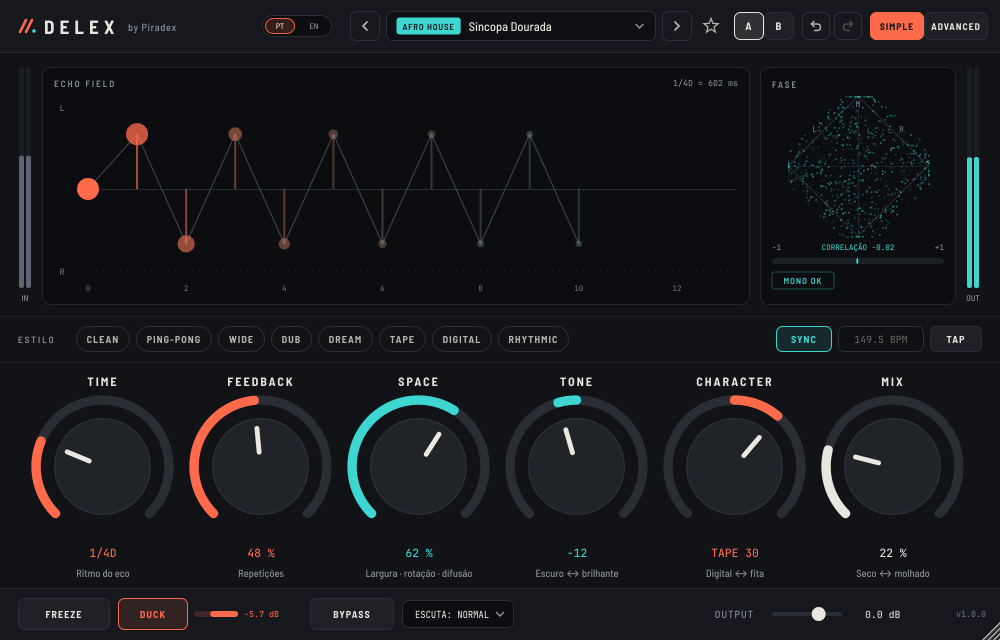
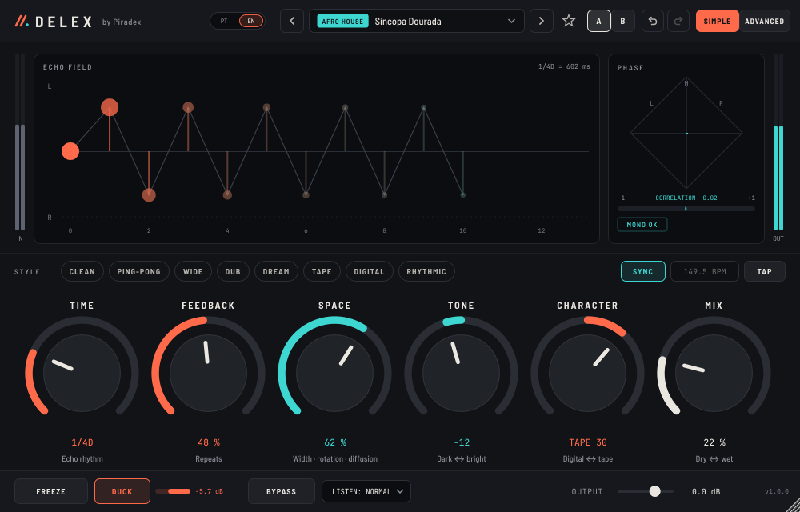

# DELEX by Piradex — v1.0.0 (delay espacial)

Delay estéreo espacial em **VST3, AU e AAX (Pro Tools)**, interface em **Português e Inglês**, para **macOS 10.13+ (Intel e Apple Silicon, num só instalador)** e **Windows 10/11 64 bits**.

| Português | English |
|---|---|
|  |  |

## O que faz

- **Delay duplo L/R** até 8 s por canal, sync com o BPM (1/1 a 1/128, pontuados e tercinas), tap tempo, modos **Dual / Ping-Pong / Mono**.
- **Matriz espacial** (rotação ou reflexão unitária) aplicada a cada repetição: os ecos rodam no estéreo sem ganhar energia.
- **Feedback moldável**: EQ no loop (low/high cut 6/12/24 dB, dois picos, low e high shelf, compensação), dispersão, difusão, saturação de fita (oversampling 2× opcional), digital grit, hiss — em qualquer das 120 ordens (lista arrastável, automatizável).
- **Delay Match** (copia o delay de uma referência ou de um stem de voz), **Throw Map** (throws por palavra, segue o DAW), **Translation Guard**, **Spectral Unmask**, **detecção de fonte**, **Seguir tempo** e **pesquisa de presets por descrição**.
- **Echo Sculpt** (desenha cada repetição), **Multi-Tap** com **grooves africanos** e **captura de groove**, **Harmonic Echo** (taps afinados dentro do tom, com detecção de tom e de nota).
- **Auto-Throw** (atira a última palavra de cada frase para o delay, sem automação), **pads** Throw / Freeze / Spin / Stop (rato ou MIDI), **Morph A↔B**, **matriz de modulação** (4 ligações), **pitch/shimmer**, **reverse**, transição **Stretch** e modelos **Fita / BBD / Multi-cabeça / Cassete / Digital 80s**.
- **Sidechain** para o ducker e o gate, **MIDI learn** (clique direito), **escuta** Normal / Só Wet / Delta / Mono / Telemóvel / Club, **volume constante**, **bloqueio** de tempo / mix / dinâmica / EQ ao trocar de preset.
- **Ducker**, **gate dos ecos** (efeito não linear), **Freeze** sem perdas, mudanças de tempo por **glide de fita** ou **crossfade**, modulação (seno/triângulo/aleatório, sync), wow & flutter.
- **Vista SIMPLE** com 6 controlos (TIME, FEEDBACK, SPACE, TONE, CHARACTER, MIX) e **vista ADVANCED** com 6 abas.
- **Idioma PT | EN**: seletor no cabeçalho, na página Utilities (INTERFACE) e no ecrã da senha. Na primeira vez segue o idioma do sistema; a escolha é partilhada por todos os plugins Piradex. Os nomes dos parâmetros no DAW não mudam (as automações continuam a funcionar).
- **282 presets** de fábrica em 19 categorias (Vocals, Afro House, Kizomba, Trap, Drums, Bass, Guitar, Synth, Ambience, Ambient, Orkestra, Mega, NonLin, VIP, FX, Lo-Fi, Dub, Transition, Master FX), com subcategorias, pesquisa, favoritos, presets do utilizador, A/B, desfazer/refazer, interface 75–200 %.

## Senha

Ao abrir pela primeira vez o plugin pede uma senha (master ou beta). As senhas **não** estão no código — só o seu hash PBKDF2. Para criar mais senhas beta: `python3 tools/nova_senha_beta.py 2027-03-31`, colar a linha gerada em `kKeys` (`Source/License.cpp`) e fazer push.

## Descarregar

Página **Releases** deste repositório → `v1.0.0`:
- `DELEX-by-Piradex-1.0.0-macOS.dmg` — instalador .pkg (VST3 + AU), Intel e Apple Silicon
- `DELEX-by-Piradex-1.0.0-Windows-Setup.exe` — instalador VST3 (ou o `.zip` para instalação manual)
- `DELEX-Manual-PT.pdf`, `DELEX-Manual-EN.pdf`, `DELEX-Curso.pdf`, `DELEX-Medicoes.pdf` e o pack `DELEX-Signature-Series-Exemplo.dlxpack`
- `DELEX-by-Piradex-1.0.0-macOS-AAX-*.zip` e `...-Windows-AAX-*.zip` — AAX para Pro Tools (ver `installer/LEIA-ME-AAX.txt`). Enquanto não houver assinatura PACE os ficheiros chamam-se `...-nao-assinado.zip` e só abrem no Pro Tools Developer; com os segredos `PACE_*` configurados no GitHub o CI assina-os automaticamente.

## Documentação

- [Manual do utilizador](docs/MANUAL.md) · [User manual (EN)](docs/MANUAL_EN.md) · PDFs em `docs/pdf` (também na release)
- [Curso DELEX — o delay como instrumento](docs/CURSO.md)
- [Medições e curvas](docs/MEDICOES.md) · [Measurements](docs/MEASUREMENTS.md)
- [Arquitetura, algoritmos e testes](docs/ARQUITETURA.md)
- [Matriz de parâmetros](docs/PARAMETROS.md)
- [Checklist de testes em DAW](docs/TESTES_DAW.md)

## Compilar

```
cmake -B build -DCMAKE_BUILD_TYPE=Release            # descarrega o JUCE 8.0.15
cmake --build build --config Release --target Delex_VST3 Delex_AU Delex_AAX
```
macOS universal: `-G Xcode -DCMAKE_OSX_ARCHITECTURES="arm64;x86_64" -DCMAKE_OSX_DEPLOYMENT_TARGET=10.13`.
Testes: `-DDLX_BUILD_TESTS=ON` → `delex_core_test` (DSP) e `delex_plugin_test` (plugin completo + capturas da interface).

O GitHub Actions compila, valida (auval Intel e Apple Silicon, pluginval) e publica os instaladores em cada push para o ramo `delex-v2`.

---
Fontes: Barlow Semi Condensed e JetBrains Mono (SIL Open Font License, ver `Resources/`). JUCE 8 (licença JUCE/AGPL).
Suporte: juninhopiradex@hotmail.com · www.beatfreakstudio.com
