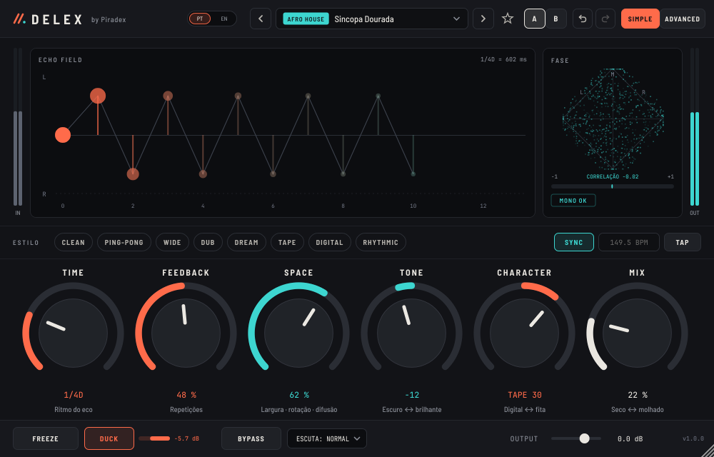

# DELEX by Piradex — Manual do utilizador (v1.0.0)

O DELEX é um delay estéreo espacial: cada repetição pode rodar no campo estéreo, ganhar textura e dissolver-se numa cauda, sem nunca disparar de volume. Tudo o que é essencial está na vista **SIMPLE**; o resto vive na vista **ADVANCED**.

## 1. Instalação

**macOS (10.13 ou superior, Intel e Apple Silicon)** — abre o `.dmg`, executa o `.pkg` e segue o instalador. Se o Mac avisar "programador não identificado": botão direito no `.pkg` → Abrir → Abrir. O mesmo instalador serve um MacBook Pro 2013 com Catalina e um Mac M1/M2/M3/M4.

**Windows 10/11 (64 bits)** — executa o `Setup.exe`. Se aparecer "O Windows protegeu o seu PC": Mais informações → Executar mesmo assim.

No DAW procura **DELEX by Piradex** (fabricante Piradex). Pode coexistir com o Delex v1.

**Senha** — na primeira vez o plugin pede uma senha (as senhas beta são válidas até 31/12/2026). Com "Lembrar neste computador" ligado não volta a pedir. Enquanto não houver senha o plugin deixa passar o áudio sem alterações, para não estragar a sessão. Em UTILITIES › SOBRE vês o estado da licença e podes **TERMINAR SESSÃO**.

**Idioma (PT | EN)** — o seletor PT | EN está no cabeçalho, em UTILITIES › INTERFACE e no ecrã da senha. A interface muda logo, sem fechar o plugin. Na primeira vez segue o idioma do sistema; a escolha é partilhada por todos os plugins Piradex. Os nomes dos parâmetros no DAW não mudam, por isso as automações continuam a funcionar.

## 2. Vista SIMPLE

| Zona | O que faz |
|---|---|
| **ECHO FIELD** | Cada ponto é uma repetição: altura = posição L/R, tamanho = volume. Um anel vazio indica que L e R estão em fase oposta. |
| **FASE** | Goniómetro e correlação da saída. "MONO OK" = soma bem em mono; "FASE INVERTIDA" = cuidado em mono. |
| **ESTILO** | Pontos de partida rápidos (CLEAN, PING-PONG, WIDE, DUB, DREAM, TAPE, DIGITAL, RHYTHMIC). Não mexem no tempo, mix nem ducking. |
| **SYNC / BPM / TAP** | SYNC liga o tempo ao BPM do projecto. TAP: toca 3–4 vezes ao ritmo (desliga o SYNC e define o tempo em ms). |
| **TIME** | Divisão musical (com SYNC) ou milissegundos (sem SYNC). D = pontuado, T = tercina. |
| **FEEDBACK** | Número de repetições. Até 100 % é estável. |
| **SPACE** | Macro: alarga a saída, junta difusão e roda os ecos. |
| **TONE** | Macro: esquerda escurece os ecos, direita abrilhanta. |
| **CHARACTER** | Macro: direita = fita (saturação, warmth, wow), esquerda = digital (bits e sample rate). |
| **MIX** | Seco ↔ molhado. Num envio auxiliar usa 100 %. |
| **FREEZE** | Congela a cauda: deixa de entrar som novo e os ecos repetem sem perdas. |
| **DUCK** | Baixa os ecos enquanto a fonte toca e solta-os nas pausas (a barra mostra a redução em dB). |
| **BYPASS / OUTPUT** | Desliga o efeito sem cliques / ganho de saída. |
| **ESCUTA** | Só para ouvir, não fica nos presets: **Normal**, **Só Wet** (só os ecos), **Delta** (só o que o delay acrescenta), **Mono**, **Telemóvel** (banda 300 Hz–4 kHz) e **Club** (graves em mono, sem agudos). A caixa fica laranja enquanto não estiver em Normal, para não te esqueceres. |

**Gestos em qualquer knob:** arrastar para cima/baixo · **Shift** + arrastar = ajuste fino · **duplo clique** = repor o valor por defeito · **duplo clique no número** = escrever um valor · **clique direito** = MIDI learn / esquecer MIDI / repor. Passar o rato mostra uma dica.

**MIDI learn:** clique direito num knob ou botão → *Aprender MIDI* → mexe num knob do teu controlador. O knob passa a mostrar `CC n`. Cada parâmetro fica ligado a um só CC e o mapa é guardado na sessão do DAW. No DAW, envia o MIDI do controlador para a pista do DELEX (no Logic e no GarageBand o DELEX aparece como efeito MIDI-controlado; no Ableton escolhe o DELEX como destino de *MIDI To*).

**Cabeçalho:** ‹ › mudam de preset · clicar no nome abre o browser · ★ favorito · **A / B** guarda duas versões para comparar (Alt+clique copia o estado actual para o outro) · ↶ ↷ desfazer/refazer · SIMPLE / ADVANCED.

## 3. Vista ADVANCED

| Aba | Controlos |
|---|---|
| **TIMING** | TIME (ms), divisão, SYNC, TAP, **R RATIO** (tempo do lado direito em relação ao esquerdo; 1.50 = 3:2), FEEDBACK, **FB L/R**, encaminhamento **Dual / Ping-Pong / Mono**, transição de tempo **Fita (glide)**, **Crossfade** ou **Stretch** (o tempo desliza ao ritmo do GLIDE sem mudar a afinação) e GLIDE. |
| **SPACE** | **ROTATION** (−180°…+180°) com modo **Rotação/Reflexão**, IN/OUT ROT (±45°; 45° converte L/R em M/S), IN/OUT WIDTH (0–200 %), macro SPACE e **MONO-SAFE** (graves dos ecos em mono). A mini-vista mostra para onde vai cada lado a cada repetição. |
| **FEEDBACK EQ** | Curva interactiva com 6 nós (LC, pico **1**, pico **2**, **LS**, **HS**, HC; arrasta; roda do rato nos picos muda o Q; duplo clique repõe). LOW CUT, SLOPE 6/12/24 dB, botões **PICO 1 / PICO 2 / SHELVES** para escolher que banda os knobs mostram, **COMPENSATE** (reduz o feedback na proporção do maior ganho positivo), HIGH CUT. **Ordem do loop**: arrasta os 5 módulos para qualquer posição (120 ordens, automatizável). |
| **MOTION** | Modulação DEPTH (cents), RATE ou divisão sincronizada, OFFSET entre L e R, forma Seno/Triângulo/Aleatório, WOW; **Dispersão** (frequência, spread em ms); **Difusão** (amount, spread). |
| **TEXTURE** | Fita: WARMTH, DRIVE. Digital grit: BIT DEPTH, SAMPLE RATE, JITTER, GRIT MIX. CHARACTER, PRE-DRIVE, **HISS** (ruído de fita só nos ecos) e **HQ 2x** (saturação com oversampling 2×: menos aliasing em drive alto; o atraso de 14 amostras é compensado no tempo). **MODELO**: Fita · **BBD** (delay analógico de chips: mais escuro quanto mais longo o tempo) · **Multi-cabeça** (três cabeças a 1/3, 2/3 e ao tempo inteiro; escolhe as cabeças) · **Cassete** (banda estreita, wow extra) · **Digital 80s** (12 bits, banda até 12 kHz). |
| **MOD** | **Matriz de modulação** com 4 ligações: fonte (LFO, envelope da entrada, aleatório, envelope do sidechain) → destino (tempo, feedback, mix, rotação, cortes, pico, drive, difusão, largura, pitch mix, reverse, profundidade da modulação, wet trim, tone, space) com quantidade ±100 %. A barra por baixo mostra a fonte a mexer. **MORPH A ↔ B**: desliza todos os parâmetros do slot actual para os do outro slot (botões e escolhas trocam a meio); automatizável. |
| **PERFORM** | **AUTO-THROW**: detecta o fim de cada frase (THRESHOLD, PAUSA) e atira a última palavra (TAMANHO) para o delay, no tempo certo — sem automação. **SÓ THROWS**: a entrada só entra no delay nos throws. **Pads** THROW · FREEZE · SPIN · STOP (rato ou MIDI, notas C1–D#1). **PITCH / SHIMMER**: afinação dentro do loop (+12 = shimmer). **REVERSE**: ecos ao contrário. |
| **UTILITIES** | Ducker (threshold, amount, attack, hold, release) com chave **INTERNO / SIDECHAIN**, **gate dos ecos** (GATE, threshold, hold, release: a cauda corta-se de repente quando a fonte pára — é o que dá o som "NonLin"), curva do MIX (linear / potência constante), **VOLUME CONST.**, WET TRIM, OUTPUT, tamanho da interface (75–200 %) e informação. |

**Sidechain** — escolhe SIDECHAIN no ducker e envia outra pista para a entrada sidechain do DELEX no DAW (ex.: a voz principal a baixar os ecos do instrumental, ou o kick a abrir o gate). O indicador diz *SIDECHAIN A RECEBER* quando chega sinal do DAW; se disser *SEM SIDECHAIN NO DAW*, o ducker e o gate continuam a ouvir a própria entrada.

**VOLUME CONST.** — mantém o volume dos ecos igual quando mexes no FEEDBACK. Serve para comparar presets e definições sem o ouvido escolher "o mais alto".

## 4. Presets

282 presets de fábrica em 19 categorias: Vocals (52), Afro House (6), Kizomba (5), Trap (6), Drums (38: Fills, Snare, Percussion), Bass (24: Ambience, Chorus, Room), Guitar (18), Synth (41), Ambience (20), Ambient (5), Orkestra (13: Chamber, Big Hall), Mega (8, cinematográficos ao estilo dos sintetizadores dos anos 80), NonLin (16: Snare, Toms — usam o gate), VIP (9, técnicas de profissionais), FX (4), Lo-Fi (5), Dub (5), Transition (4) e Master FX (3). No cabeçalho do browser, **BLOQUEAR** TEMPO / MIX / DINÂM. / EQ mantém esses grupos quando trocas de preset (ex.: percorrer presets sem perder o tempo e o mix acertados para a música); a escolha fica guardada no computador. A subcategoria aparece ao lado da descrição e também se pode procurar ("Room", "Snare"…). No browser: pesquisa por nome, fonte ou resultado ("voz", "ping-pong", "escuro"…), categorias, ★ favoritos, **GUARDAR COMO…** para os teus e **PASTA** para abrir a pasta dos presets do utilizador. Duplo clique ou CARREGAR aplica o preset.

Pasta dos presets do utilizador:
- macOS: `~/Library/Application Support/Piradex/DELEX/Presets`
- Windows: `%APPDATA%\Piradex\DELEX\Presets`

## 5. Receitas rápidas

- **Throw da última palavra, sem automação** — PERFORM: AUTO-THROW + SÓ THROWS, TAMANHO 250 ms, PAUSA 120 ms, THRESHOLD logo abaixo do nível da voz. Tempo 1/4 ou 1/8D, FEEDBACK 35 %, DUCK ligado.
- **Shimmer** — PERFORM: PITCH +12, PITCH MIX 40 %; TEXTURE: difusão 60 %; FEEDBACK 70 %.
- **Transição entre dois sons** — faz um delay curto em A e uma cauda enorme em B; volta a A e automatiza o MORPH de 0 a 100 % na passagem para o refrão.
- **Ecos que respiram com a voz** — MOD: Envelope → MIX +40 %, ou Sidechain (voz) → FEEDBACK −50 %.

- **Voz à frente** — preset *Voz à Frente 1/8*, MIX 100 % num envio, DUCK ligado.
- **Afro House sincopado** — *Sincopa Dourada* ou estilo PING-PONG com TIME 1/4D.
- **Throw de trap** — *Throw 1/8D*; automatiza o volume do envio na última palavra.
- **Transição** — *Freeze Riser*: carrega em FREEZE no último tempo antes do drop.
- **808** — *808 Sombra* (mono, só graves, pouco mix).

## 6. Dicas e limites

- Feedback alto + pico do EQ positivo com COMPENSATE a 0 % cria auto-oscilação controlada (efeito dub). O limitador interno impede picos perigosos, mas baixa o volume do monitor antes de experimentar.
- O AAX (Pro Tools) só abre no Pro Tools normal depois de assinado com PACE (ver `installer/LEIA-ME-AAX.txt`).
- Checklist de testes em DAW antes de cada lançamento: [TESTES_DAW.md](TESTES_DAW.md).

Suporte: juninhopiradex@hotmail.com · www.beatfreakstudio.com
