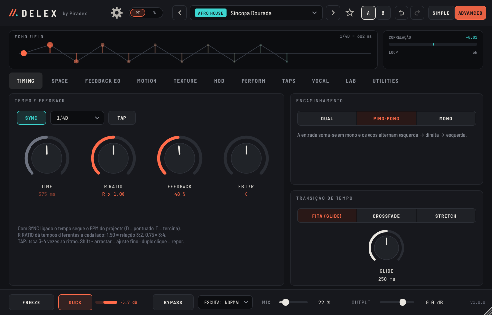
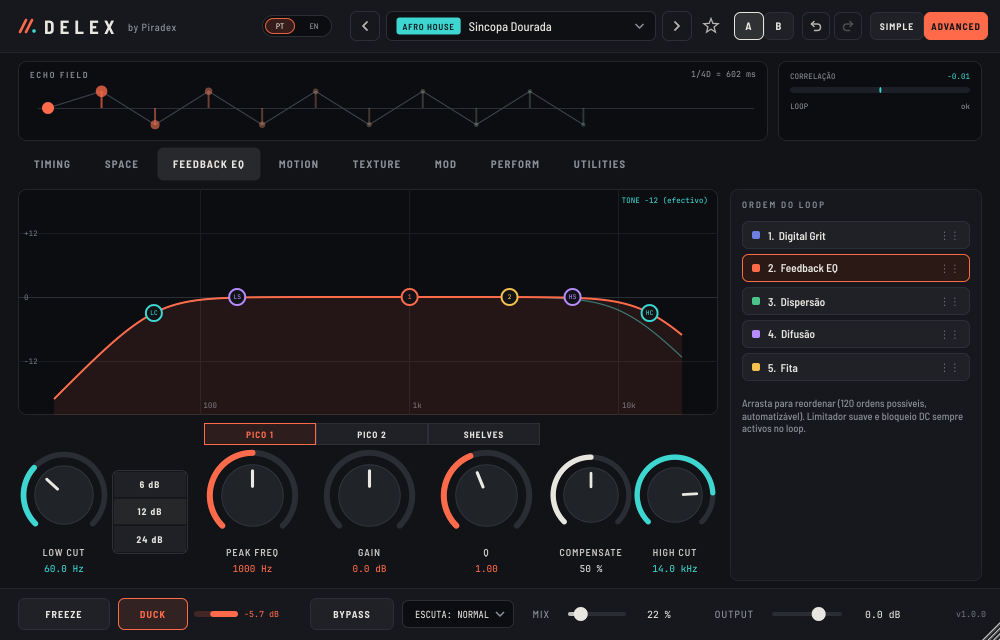
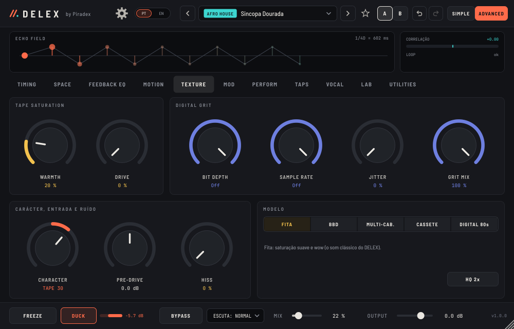
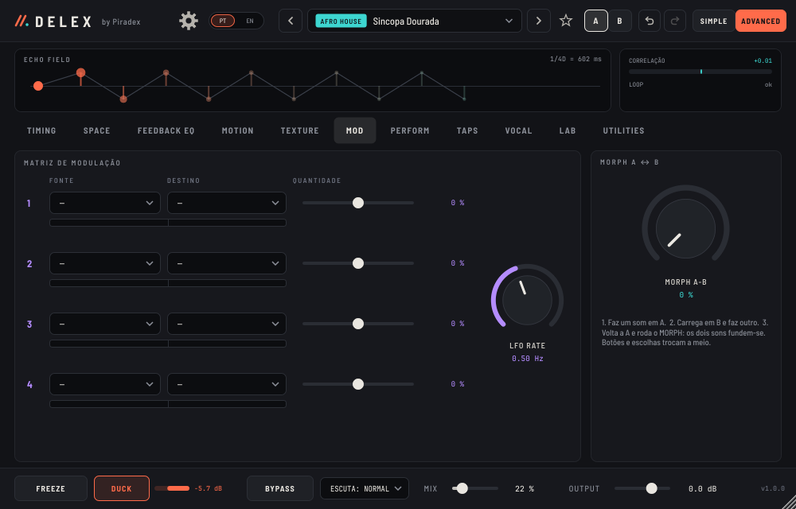
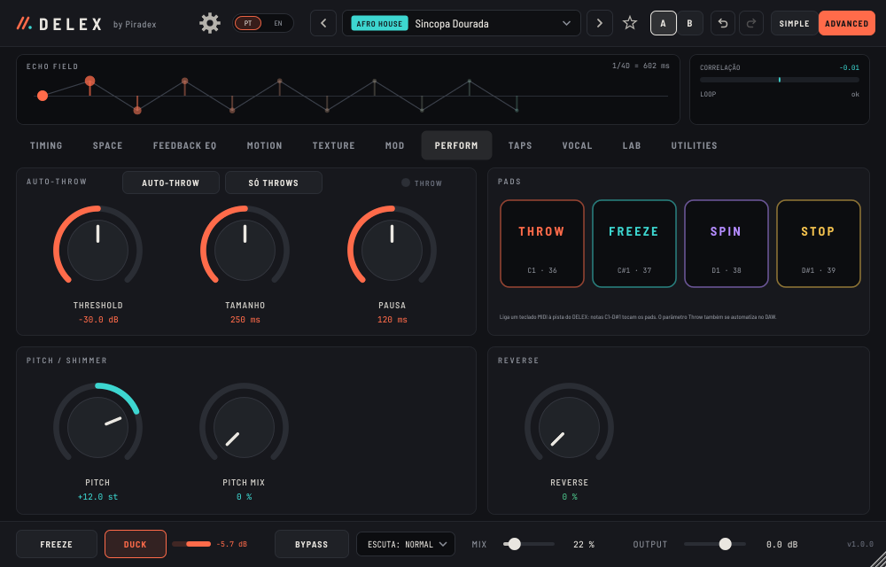
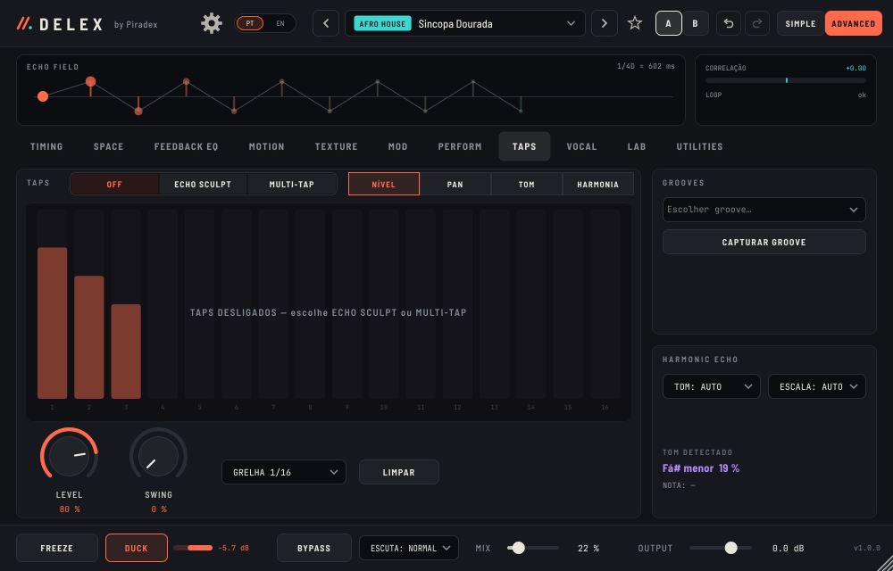
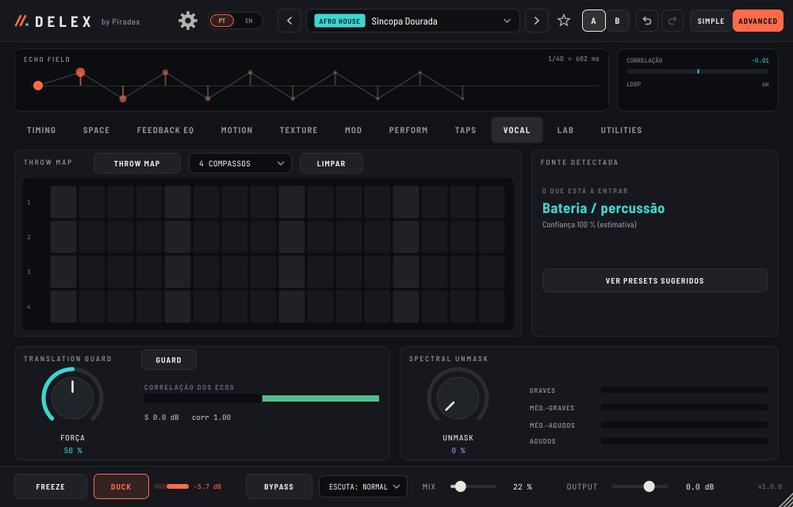
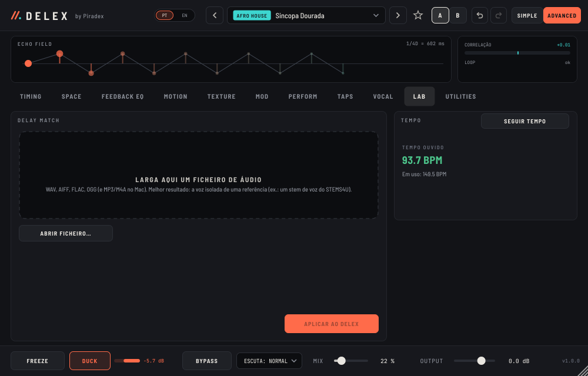
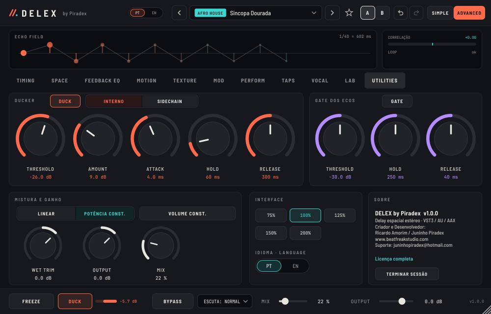

# DELEX by Piradex — Manual do utilizador

**Versão 1.0.0** · Delay espacial estéreo · VST3 / AU / AAX · macOS 10.13+ (Intel e Apple Silicon) e Windows 10/11
Criador e Desenvolvedor: **Ricardo Amorim / Juninho Piradex** · www.beatfreakstudio.com · Suporte: juninhopiradex@hotmail.com

---

## Índice

1. O que é o DELEX
2. Instalação, senha e idioma
3. Conceitos em 5 minutos
4. Vista SIMPLE
5. Cabeçalho e rodapé
6. Vista ADVANCED, aba a aba
7. Presets, packs e pesquisa
8. MIDI: learn, pads e notas
9. Receitas por estilo
10. Medições
11. Resolução de problemas
12. Referência rápida

---

## 1. O que é o DELEX

O DELEX é um delay estéreo em que **cada repetição se pode mover no espaço**: os ecos rodam no campo estéreo, ganham textura e dissolvem-se numa cauda, sem nunca dispararem de volume.

Também resolve os problemas que fazem perder tempo na mistura:

- a **última palavra** que tem de ir para o delay sem desenhar automação (Auto-Throw);
- os ecos que **embrulham a voz** (Ducker, Spectral Unmask);
- os ecos que **desaparecem em mono** ou no telemóvel (Translation Guard);
- o tempo que **não bate** com a música (SYNC, Seguir tempo, Delay Match);
- os ritmos que **não soam africanos** (grooves em taps, captura de groove).

A interface tem duas vistas:

- **SIMPLE**: seis controlos, para chegar ao som em segundos.
- **ADVANCED**: onze abas com tudo o resto.

Tudo funciona em **Português e Inglês**.

---

## 2. Instalação, senha e idioma

**macOS (10.13 ou superior, Intel e Apple Silicon)**

1. Abre o `.dmg`.
2. Executa o `.pkg`.

O mesmo instalador serve um MacBook Pro 2013 com Catalina e um Mac M1/M2/M3/M4. Se o Mac disser "programador não identificado": botão direito no `.pkg` → Abrir → Abrir.

**Windows 10/11 (64 bits)**

1. Executa o `Setup.exe`.

Se aparecer "O Windows protegeu o seu PC": Mais informações → Executar mesmo assim. Também há um `.zip` para instalação manual: copia `DELEX by Piradex.vst3` para `C:\Program Files\Common Files\VST3`.

**Pro Tools (AAX)**: usa os ficheiros `*-AAX-*.zip` e segue o `LEIA-ME-AAX.txt`.

- O Pro Tools normal exige o AAX assinado pela PACE.
- Os ficheiros "nao-assinado" abrem no Pro Tools Developer.

No DAW procura **DELEX by Piradex** (fabricante Piradex).

- O plugin aceita MIDI, para o MIDI learn e os pads.
- No Logic aparece como efeito controlado por MIDI.

**Senha**

- Na primeira vez o plugin pede uma senha (master ou beta).
- Com "Lembrar neste computador" ligado, não volta a pedir.
- Sem sessão iniciada, o DELEX deixa passar o áudio sem alterações, para não estragar a sessão.
- Em UTILITIES › SOBRE vês o estado da licença e podes **TERMINAR SESSÃO**.

**Idioma**

- Carrega no botão **⚙ OPÇÕES** do cabeçalho e escolhe **Português** ou **English**. O mesmo menu muda o tamanho da interface.
- Também tens o seletor **PT | EN** no cabeçalho, em UTILITIES › INTERFACE e no ecrã da senha.
- A interface muda logo, sem fechar o plugin.
- A escolha é partilhada por todos os plugins Piradex.
- Os nomes dos parâmetros no DAW ficam sempre iguais, por isso as automações continuam a funcionar.

---

## 3. Conceitos em 5 minutos

**Seco e molhado.**

- O som original é o *seco*; os ecos são o *molhado*.
- **MIX** equilibra os dois.
- Num **envio auxiliar** usa MIX 100 % e controla o volume no envio.
- Num **insert** usa MIX 10–30 %.

**O loop de feedback.**

- Cada eco volta a entrar no delay. **FEEDBACK** é quanto volta.
- Dentro do loop há cinco módulos: EQ, saturação de fita, difusão, dispersão e grit digital.
- Os módulos agem *em cada volta*: um corte de agudos suave torna-se, à 6.ª repetição, uma cauda escura.
- Um limitador suave e um bloqueio DC estão sempre ligados no loop, por isso podes chegar a 100 % de feedback sem perigo.

**A matriz espacial.**

- Em cada repetição, os ecos esquerdo e direito passam por uma rotação (ou reflexão).
- Com ROTATION a 30°, cada eco nasce um pouco mais ao lado do anterior.
- É uma operação unitária: o estéreo move-se sem ganhar energia.

**Sync.**

- Com **SYNC** o tempo é uma figura musical do BPM do projecto (1/4, 1/8D, 1/16T…).
- D = pontuado, T = tercina.

---

## 4. Vista SIMPLE

| Zona | O que faz |
|---|---|
| **ECHO FIELD** | Cada ponto é uma repetição. Altura = posição L/R; tamanho = volume. Um anel vazio indica L e R em fase oposta. |
| **FASE** | Goniómetro e correlação da saída. "MONO OK" = soma bem em mono. |
| **ESTILO** | CLEAN, PING-PONG, WIDE, DUB, DREAM, TAPE, DIGITAL, RHYTHMIC. São pontos de partida que não mexem no tempo, no mix nem no ducking. |
| **SYNC · BPM · TAP** | SYNC liga o tempo ao BPM. TAP: toca 3–4 vezes ao ritmo; desliga o SYNC e define o tempo em ms. |
| **TIME** | Divisão musical (com SYNC) ou milissegundos (1 ms – 8 s). |
| **FEEDBACK** | Número de repetições. Até 100 % é estável. |
| **SPACE** | Macro: largura de saída, difusão e rotação. |
| **TONE** | Macro: para a esquerda escurece os ecos, para a direita abrilhanta-os. |
| **CHARACTER** | Macro: direita = fita (saturação, warmth, wow); esquerda = digital (bits e taxa de amostragem). |
| **MIX** | Seco ↔ molhado. |

**Gestos em qualquer knob**

- Arrastar para cima ou para baixo muda o valor.
- **Shift** + arrastar = ajuste fino.
- **Duplo clique** = repor o valor por defeito.
- **Duplo clique no número** = escrever um valor.
- **Clique direito** = Aprender MIDI / Esquecer MIDI / Repor valor.

---

## 5. Cabeçalho e rodapé

**Cabeçalho**

- **‹ ›**: preset anterior / seguinte.
- Nome do preset: abre o **browser**.
- **★**: favorito.
- **A / B**: guarda duas versões. **Alt+clique** copia o estado actual para o outro slot.
- **↶ ↷**: desfazer / refazer.
- **SIMPLE / ADVANCED**: troca de vista.

**Rodapé**

- **FREEZE**: congela a cauda. Não entra som novo e os ecos repetem sem perdas.
- **DUCK**: os ecos baixam enquanto a fonte toca. A barra ao lado mostra a redução em dB.
- **BYPASS**: desliga o efeito sem cliques.
- **ESCUTA**: só para ouvir, não fica nos presets. A caixa fica laranja fora de Normal, para não te esqueceres.
  - **Normal**
  - **Só Wet**: só os ecos.
  - **Delta**: só o que o delay acrescenta, à mistura actual.
  - **Mono**
  - **Telemóvel**: banda 400 Hz – 3,5 kHz.
  - **Club**: graves em mono.
- **MIX** (na vista ADVANCED) e **OUTPUT**.

---

## 6. Vista ADVANCED, aba a aba

No topo ficam o ECHO FIELD e a FASE; por baixo, onze abas.

### TIMING

- **TIME** (ms), **SYNC** + divisão, **TAP**.
- **R RATIO**: tempo do lado direito em relação ao esquerdo. 1.50 = relação 3:2; 0.75 = 3:4.
- **FEEDBACK** e **FB L/R** (equilíbrio do feedback entre os lados).
- **Encaminhamento**:
  - **Dual**: dois delays.
  - **Ping-Pong**: entrada somada; os ecos alternam esquerda → direita.
  - **Mono**: um só eco, centrado. Ideal para 808 e baixos.
- **Transição de tempo** e **GLIDE**:
  - **Fita (glide)**: o tempo desliza com mudança de afinação.
  - **Crossfade**: troca suave sem mudar a afinação.
  - **Stretch**: o tempo desliza ao ritmo do GLIDE, mas sem mudar a afinação.

### SPACE

- **ROTATION** (−180°…+180°), em modo **Rotação** ou **Reflexão**. A reflexão espelha o campo em cada repetição.
- **IN ROT / OUT ROT** (±45°). A 45° converte L/R em M/S.
- **IN WIDTH / OUT WIDTH** (0–200 %). Acima de 100 % o nível é compensado.
- Macro **SPACE**.
- **MONO-SAFE**: graves dos ecos (< 150 Hz) em mono.

### FEEDBACK EQ

**A curva** tem 6 nós: **LC** (low cut), pico **1**, pico **2**, **LS** (low shelf), **HS** (high shelf) e **HC** (high cut).

- Arrasta os nós para os mover.
- A roda do rato num pico muda o Q.
- Duplo clique num nó repõe-no.

**Knobs**

- **LOW CUT** e **SLOPE** (6/12/24 dB por oitava).
- **PICO 1 / PICO 2 / SHELVES**: escolhe que banda os knobs mostram.
- **COMPENSATE**: baixa o feedback na proporção do maior ganho positivo, para o loop não disparar.
- **HIGH CUT**.

Com COMPENSATE a 0 % e um pico positivo, o loop pode auto-oscilar (efeito dub). O limitador protege, mas baixa o monitor antes de experimentar.

**ORDEM DO LOOP**: arrasta Digital Grit, Feedback EQ, Dispersão, Difusão e Fita para qualquer posição. São 120 ordens, automatizáveis.

### MOTION

- **Modulação**:
  - DEPTH (cents);
  - RATE ou divisão sincronizada;
  - OFFSET entre L e R (50 % = opostos);
  - forma Seno / Triângulo / Aleatório;
  - **WOW** (wow e flutter de fita).
- **Dispersão**: frequência e spread em ms. Espalha o eco no tempo (efeito "chirp").
- **Difusão**: amount e spread. Vai do eco discreto a uma cauda tipo reverb.

### TEXTURE

- **Fita**: WARMTH (pré-ênfase) e DRIVE (saturação com anti-aliasing).
- **Digital grit**: BIT DEPTH, SAMPLE RATE, JITTER, GRIT MIX.
- **CHARACTER**, **PRE-DRIVE** e **HISS** (ruído de fita só nos ecos).
- **MODELO**:
  - **Fita**: o som clássico do DELEX.
  - **BBD**: delay analógico de chips. Quanto mais longo o tempo, mais escuro.
  - **Multi-cabeça**: três cabeças a 1/3, 2/3 e ao tempo inteiro. Escolhe as cabeças: 1, 2, 3, 1+2, 1+3, 2+3 ou 1+2+3.
  - **Cassete**: banda estreita, wow extra e pequenas variações de nível.
  - **Digital 80s**: 12 bits e banda até 12 kHz.
- **HQ 2x**: saturação com oversampling 2×. O atraso de 14 amostras é compensado no tempo.

### MOD

**Matriz de modulação** com 4 ligações. Cada ligação tem:

- uma **fonte**:
  - **LFO** (seno, LFO RATE);
  - **Envelope** da entrada;
  - **Aleatório** (sample & hold ao RATE);
  - **Sidechain** (envelope da entrada sidechain);
- um **destino**: TEMPO, FEEDBACK, MIX, ROTATION, LOW CUT, HIGH CUT, PEAK FREQ, DRIVE, DIFUSÃO, OUT WIDTH, PITCH MIX, REVERSE, MOD DEPTH, WET TRIM, TONE ou SPACE;
- uma **quantidade**: ±100 % = toda a escala do destino.

TEMPO é especial: multiplica o tempo final (±1 oitava) e funciona com SYNC. A barra por baixo de cada linha mostra a fonte a mexer.

**MORPH A ↔ B** desliza todos os parâmetros do slot actual para os do outro. Botões e escolhas trocam a meio. Automatiza-o para passar de um som a outro numa transição.

### PERFORM

**AUTO-THROW**

- O DELEX detecta o fim de cada frase: o nível fica abaixo do **THRESHOLD** durante a **PAUSA**.
- Escreve então a última palavra (**TAMANHO**) directamente na linha de atraso, no sítio onde teria entrado.
- O eco sai no tempo certo, como se tivesses aberto o envio antes da palavra.
- O indicador THROW pisca a cada throw.

**SÓ THROWS**: a entrada só entra no delay nos throws:

- Auto-Throw;
- pad THROW;
- Throw Map;
- parâmetro **Throw** automatizado.

**Pads** (rato ou MIDI):

- **THROW**: atira já a última frase e mantém o envio aberto.
- **FREEZE**
- **SPIN**: uma volta completa ao estéreo por compasso.
- **STOP**: tape stop; ao soltar, os ecos voltam.

**PITCH / SHIMMER**: afinação dentro do loop. Cada repetição sobe (ou desce) de novo; +12 com PITCH MIX ≈ 40 % é o shimmer.

**REVERSE**: ecos ao contrário, em segmentos do tamanho do tempo.

### TAPS

**Modos**

- **ECHO SCULPT**: desenha cada uma das 16 repetições. Substitui os ecos do loop.
- **MULTI-TAP**: até 31 ecos em posições livres da grelha (1/16, 1/16T ou 1/8), somados aos ecos do loop. **SWING** atrasa as semicolcheias fracas.

**Faixas**

- **NÍVEL**, **PAN** e **TOM** (filtro de cada tap).
- **HARMONIA**: clique muda o intervalo (3.ª, 5.ª, oitava, −oitava, 4.ª, 6.ª, 7.ª).
- Clique direito apaga um passo.

**GROOVES**: padrões inspirados em ritmos africanos e da diáspora:

- Kizomba
- Semba
- Kuduro
- Afro House
- Amapiano (log drum)
- Gqom
- Afrobeats 3-3-2
- Highlife
- Coupé-Décalé
- Sino 12/8
- Marrabenta
- Tarraxinha

**CAPTURAR GROOVE**

1. Carrega no botão.
2. Toca um compasso (bateria, percussão, voz…).
3. O DELEX espera pelo primeiro ataque, ouve um compasso e transforma os ataques em taps.

**HARMONIC ECHO**

- O **tom** é detectado na entrada, ou escolhes TOM e ESCALA.
- A **nota** actual também é detectada.
- Os intervalos são diatónicos: uma "3.ª" pode ser maior ou menor consoante o grau, por isso o eco harmoniza dentro do tom.

### VOCAL

**THROW MAP**

- Marca as palavras e frases a atirar, em 1 a 8 compassos de semicolcheias.
- Com o DAW a tocar, o envio abre nesses passos.
- Usa com SÓ THROWS.

**FONTE DETECTADA**

- O DELEX ouve o que entra: voz, bateria/percussão, baixo/808, guitarra/teclas, pad/sintetizador ou mistura completa.
- **VER PRESETS SUGERIDOS** abre a categoria certa.

**TRANSLATION GUARD** protege os ecos em mono, telemóvel e clube:

- corrige ecos em contrafase, invertendo suavemente a polaridade do lado direito dos ecos;
- limita a largura até à correlação mínima dada pela **FORÇA**;
- põe os graves dos ecos em mono.

**SPECTRAL UNMASK**

- Os ecos baixam (até 12 dB) só nas bandas onde a fonte, ou o sidechain, está a tocar: graves, médios-graves, médios-agudos e agudos.
- A voz fica limpa e a cauda continua lá.

### LAB

**DELAY MATCH**

1. Larga um ficheiro na zona tracejada, ou usa ABRIR FICHEIRO. Formatos: WAV, AIFF, FLAC, OGG; no Mac também MP3 e M4A.
2. O DELEX mede o delay que lá está: tempo, feedback, brilho dos ecos (TONE), largura e se é ping-pong.
3. Carrega em **APLICAR AO DELEX** para copiar esses valores. Se o tempo estiver a ±3 % de uma divisão musical do BPM actual, o SYNC liga-se.

O melhor resultado obtém-se com a **voz isolada** de uma referência, por exemplo um stem de voz do **STEMS4U**: o ritmo dos outros instrumentos não confunde a medição.

**SEGUIR TEMPO**: usa o tempo ouvido na entrada em vez do do DAW (ao vivo, ou num DAW sem tempo).

**SIGNATURE SERIES**: importar packs (ver 7).

### UTILITIES

- **DUCKER**:
  - THRESHOLD, AMOUNT, ATTACK, HOLD, RELEASE;
  - chave **INTERNO / SIDECHAIN**;
  - o indicador diz *SIDECHAIN A RECEBER* quando chega sinal do DAW.
- **GATE DOS ECOS**: GATE, THRESHOLD, HOLD, RELEASE. A cauda corta-se de repente quando a fonte pára — o som "NonLin".
- **MISTURA E GANHO**:
  - curva LINEAR / POTÊNCIA CONST.;
  - **VOLUME CONST.**: o volume dos ecos fica igual quando mexes no feedback, para comparar sem enganar o ouvido;
  - WET TRIM, OUTPUT, MIX.
- **INTERFACE**: tamanho 75–200 % e idioma.
- **SOBRE**: versão, créditos, licença, TERMINAR SESSÃO.

---

## 7. Presets, packs e pesquisa

**482 presets de fábrica** em 30 categorias. Os 200 do guia *Delay FX · 200 presets profissionais* (Beatfreak Music) estão nas categorias Classic, Stereo, Vintage, Rhythmic, Afro, EDM, Pitch, Reverse, Modulation, Mixing e Next Gen, e também em Vocals, Trap, Guitar, Drums, Synth, Ambient, FX e Dub. As 19 categorias originais:

| Categoria | Presets |
|---|---|
| Vocals | 52 |
| Afro House | 6 |
| Kizomba | 5 |
| Trap | 6 |
| Drums (Fills, Snare, Percussion) | 38 |
| Bass (Ambience, Chorus, Room) | 24 |
| Guitar | 18 |
| Synth | 41 |
| Ambience | 20 |
| Ambient | 5 |
| Orkestra (Chamber, Big Hall) | 13 |
| Mega (cinematográficos) | 8 |
| NonLin (Snare, Toms) | 16 |
| VIP (técnicas de estúdio) | 9 |
| FX | 4 |
| Lo-Fi | 5 |
| Dub | 5 |
| Transition | 4 |
| Master FX | 3 |

**Pesquisa por descrição**

Escreve o que queres ouvir, por exemplo:

- "voz escura e larga"
- "caixa curta"
- "dark wide vocal"
- "groove kizomba"

O DELEX percebe sinónimos em português e inglês e ordena pelos mais próximos: categoria, depois nome, etiquetas e descrição.

**No browser**

- ★ favoritos;
- **GUARDAR COMO…** para os teus presets;
- **PASTA** abre a pasta dos presets;
- duplo clique ou **CARREGAR** aplica o preset.

**BLOQUEAR** TEMPO / MIX / DINÂM. / EQ mantém esses grupos ao trocar de preset. Assim percorres presets sem perder o tempo e o mix acertados para a música.

**Packs Signature Series (.dlxpack)**

- **IMPORTAR PACK…**: os presets aparecem em *Utilizador*, com o nome do pack e o autor.
- Cada preset traz o seu SHA-256: um pack alterado é recusado.
- **EXPORTAR PACK…**: junta os teus presets num pack para partilhar ou vender.
- Em alternativa, `tools/make_pack.py` cria packs com capa e descrições por preset.

**Pasta dos presets do utilizador**

- macOS: `~/Library/Application Support/Piradex/DELEX/Presets`
- Windows: `%APPDATA%\Piradex\DELEX\Presets`

---

## 8. MIDI: learn, pads e notas

**MIDI learn**

1. Clique direito num knob ou botão → *Aprender MIDI*.
2. Mexe num controlo do teu controlador.

O knob passa a mostrar `CC n`. Cada parâmetro fica ligado a um só CC e o mapa é guardado na sessão.

**Pads por MIDI**

| Nota | Pad |
|---|---|
| C1 (36) | THROW |
| C#1 (37) | FREEZE |
| D1 (38) | SPIN |
| D#1 (39) | STOP |

**Enviar MIDI ao DELEX**

| DAW | Como |
|---|---|
| Logic | escolhe a pista do DELEX como destino MIDI |
| Ableton | numa pista MIDI, *MIDI To* = pista do DELEX → DELEX |
| FL Studio | porta MIDI do wrapper |
| Reaper | envio MIDI para a pista |

---

## 9. Receitas por estilo

**Kizomba / Tarraxinha — voz principal**

- Preset *Kizomba Romântica* num envio a 100 %.
- DUCK ligado.
- VOCAL › UNMASK 40 %.
- Para groove nos ecos: TAPS › GROOVES › Kizomba, LEVEL 60 %.

**Afro House — sincopado e largo**

- *Sincopa Dourada*, ou o estilo PING-PONG com TIME 1/4D.
- TAPS › Afro House por cima.
- SPACE 50 %.

**Amapiano**

- TIME 1/4D, MODELO BBD.
- TAPS › Amapiano (log drum).
- Na bateria: NonLin com GATE.

**Trap / Drill — throw da última palavra**

- PERFORM: AUTO-THROW + SÓ THROWS.
- TAMANHO 250 ms, PAUSA 120 ms.
- TIME 1/8D, FEEDBACK 35 %.

**Pop / R&B — voz limpa com cauda**

- TIME 1/4, FEEDBACK 40 %.
- DUCKER › SIDECHAIN com a própria voz.
- UNMASK 60 %, GUARD ligado.

**Shimmer cinematográfico**

- PITCH +12, PITCH MIX 40 %.
- Difusão 60 %, FEEDBACK 70 %.

**Tape echo vintage**

- MODELO Multi-cabeça, cabeças 1+2+3.
- DRIVE 30 %, WOW 20 %.

**Transição para o refrão**

1. Em A, faz um delay curto.
2. Em B, faz uma cauda enorme com o FREEZE preparado.
3. Volta a A e automatiza o MORPH de 0 a 100 % nos 2 compassos antes do refrão.
4. Usa o pad STOP no último tempo.

**Copiar o delay de uma referência**

1. Separa a voz da referência no STEMS4U.
2. Larga o stem em LAB › DELAY MATCH.
3. Carrega em APLICAR AO DELEX.

**Mistura e master**

- Categoria Master FX, com MIX baixo (5–10 %).
- MONO-SAFE e GUARD ligados.
- Confirma em ESCUTA › Mono e › Telemóvel.

---

## 10. Medições

As curvas objectivas do motor estão em [MEDICOES.md](MEDICOES.md), seguindo a metodologia do ANALYSER by Piradex: cauda por modelo, resposta das repetições, THD e harmónicos, aliasing, ducker, precisão do tempo e CPU.

Destaques:

- feedback 50 % dá exactamente −6 dB por repetição;
- o erro de tempo é ≤ 1 amostra, de 1 ms a 8 s;
- latência 0;
- aliasing a −109 dB com HQ 2x.

---

## 11. Resolução de problemas

| Problema | Solução |
|---|---|
| O plugin não aparece | Faz um rescan de plugins. No Mac, confirma que o AU está em `/Library/Audio/Plug-Ins/Components`. No Logic, reabre o Gestor de Plug-ins. |
| Não se ouve efeito | Confirma a sessão (UTILITIES › SOBRE), o MIX, o BYPASS e a ESCUTA (Normal). Com SÓ THROWS ligado, só os throws entram no delay. |
| Os ecos não seguem o BPM | Liga SYNC. Sem tempo do DAW, usa TAP ou SEGUIR TEMPO. |
| O sidechain não funciona | Escolhe SIDECHAIN no ducker e liga a entrada sidechain no DAW (ver docs/TESTES_DAW.md). O indicador deve dizer *A RECEBER*. |
| O MIDI learn não reage | O MIDI do controlador tem de chegar à pista do DELEX (ver 8). |
| O volume sobe ao aumentar o feedback | É natural: há mais repetições. Liga VOLUME CONST. para comparar. |
| A cauda soa fraca em mono | Liga GUARD e confirma em ESCUTA › Mono. |
| O Delay Match diz "sem eco claro" | Usa a voz isolada (stem) e um trecho com frases e pausas. Ficheiros com menos de 3 s não servem. |

**Suporte**: juninhopiradex@hotmail.com. Indica o sistema, o DAW, a versão e envia uma captura.

---

## 12. Referência rápida

| Gesto | Acção |
|---|---|
| Shift + arrastar | ajuste fino |
| Duplo clique | repor |
| Duplo clique no número | escrever valor |
| Clique direito | MIDI learn / esquecer / repor |
| Alt + clique em A/B | copiar estado para o outro slot |
| Roda do rato num pico do EQ | mudar o Q |
| Notas C1–D#1 | pads THROW, FREEZE, SPIN, STOP |

Fontes da interface: Barlow Semi Condensed e JetBrains Mono (SIL Open Font License). Feito com JUCE.
© Ricardo Amorim / Juninho Piradex · www.beatfreakstudio.com
