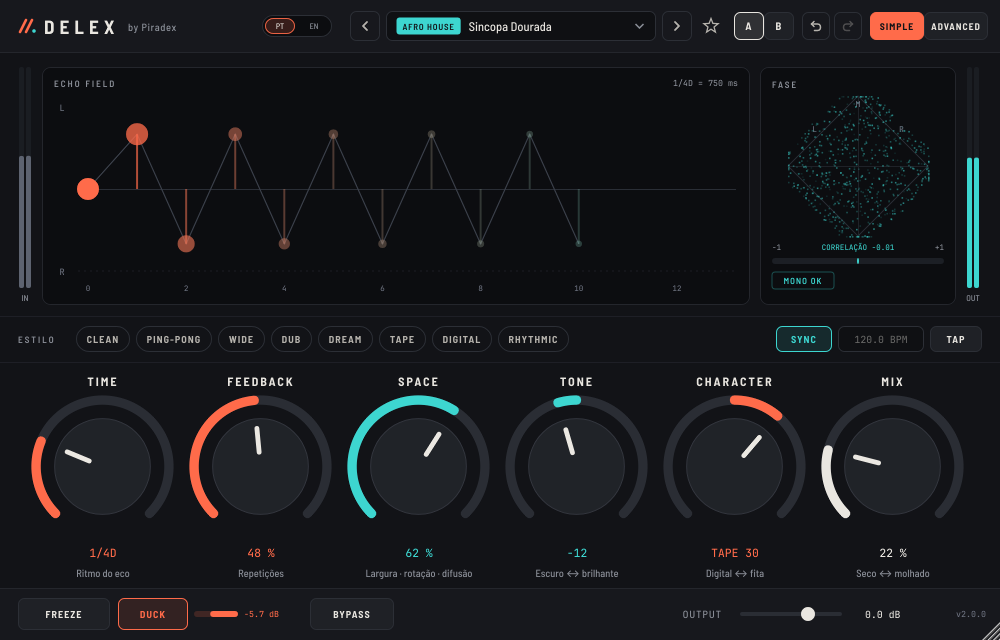

# DELEX by Piradex — Manual do utilizador (v2.0)

O DELEX é um delay estéreo espacial: cada repetição pode rodar no campo estéreo, ganhar textura e dissolver-se numa cauda, sem nunca disparar de volume. Tudo o que é essencial está na vista **SIMPLE**; o resto vive na vista **ADVANCED**.

## 1. Instalação

**macOS (10.13 ou superior, Intel e Apple Silicon)** — abre o `.dmg`, executa o `.pkg` e segue o instalador. Se o Mac avisar "programador não identificado": botão direito no `.pkg` → Abrir → Abrir. O mesmo instalador serve um MacBook Pro 2013 com Catalina e um Mac M1/M2/M3/M4.

**Windows 10/11 (64 bits)** — executa o `Setup.exe`. Se aparecer "O Windows protegeu o seu PC": Mais informações → Executar mesmo assim.

No DAW procura **DELEX by Piradex** (fabricante Piradex). Pode coexistir com o Delex v1.

## 2. Vista SIMPLE

| Zona | O que faz |
|---|---|
| **ECHO FIELD** | Cada ponto é uma repetição: altura = posição L/R, tamanho = volume. Um anel vazio indica que L e R estão em fase oposta. |
| **FASE** | Goniómetro e correlação da saída. "MONO OK" = soma bem em mono; "FASE INVERTIDA" = cuidado em mono. |
| **ESTILO** | Pontos de partida rápidos (CLEAN, PING-PONG, WIDE, DUB, DREAM, TAPE, DIGITAL, RHYTHMIC). Não mexem no tempo, mix nem ducking. |
| **SYNC / BPM / TAP** | SYNC liga o tempo ao BPM do projecto. TAP: toca 3–4 vezes ao ritmo (desliga o SYNC e define o tempo em ms). |
| **TIME** | Divisão musical (com SYNC) ou milissegundos (sem SYNC). D = pontuado, T = tercina. |
| **FEEDBACK** | Número de repetições. Até 100 % é estável. |
| **SPACE** | Macro: alarga a saída, junta difusão e roda os ecos. |
| **TONE** | Macro: esquerda escurece os ecos, direita abrilhanta. |
| **CHARACTER** | Macro: direita = fita (saturação, warmth, wow), esquerda = digital (bits e sample rate). |
| **MIX** | Seco ↔ molhado. Num envio auxiliar usa 100 %. |
| **FREEZE** | Congela a cauda: deixa de entrar som novo e os ecos repetem sem perdas. |
| **DUCK** | Baixa os ecos enquanto a fonte toca e solta-os nas pausas (a barra mostra a redução em dB). |
| **BYPASS / OUTPUT** | Desliga o efeito sem cliques / ganho de saída. |

**Gestos em qualquer knob:** arrastar para cima/baixo · **Shift** + arrastar = ajuste fino · **duplo clique** = repor o valor por defeito · **duplo clique no número** = escrever um valor. Passar o rato mostra uma dica.

**Cabeçalho:** ‹ › mudam de preset · clicar no nome abre o browser · ★ favorito · **A / B** guarda duas versões para comparar (Alt+clique copia o estado actual para o outro) · ↶ ↷ desfazer/refazer · SIMPLE / ADVANCED.

## 3. Vista ADVANCED

| Aba | Controlos |
|---|---|
| **TIMING** | TIME (ms), divisão, SYNC, TAP, **R RATIO** (tempo do lado direito em relação ao esquerdo; 1.50 = 3:2), FEEDBACK, **FB L/R**, encaminhamento **Dual / Ping-Pong / Mono**, transição de tempo **Fita (glide)** ou **Crossfade** e GLIDE. |
| **SPACE** | **ROTATION** (−180°…+180°) com modo **Rotação/Reflexão**, IN/OUT ROT (±45°; 45° converte L/R em M/S), IN/OUT WIDTH (0–200 %), macro SPACE e **MONO-SAFE** (graves dos ecos em mono). A mini-vista mostra para onde vai cada lado a cada repetição. |
| **FEEDBACK EQ** | Curva interactiva (arrasta os nós; roda do rato no pico muda o Q), LOW CUT, SLOPE 6/12/24 dB, PEAK FREQ/GAIN/Q, **COMPENSATE** (reduz o feedback quando o pico sobe, para o loop não disparar), HIGH CUT e a **ordem dos módulos** no loop. |
| **MOTION** | Modulação DEPTH (cents), RATE ou divisão sincronizada, OFFSET entre L e R, forma Seno/Triângulo/Aleatório, WOW; **Dispersão** (frequência, spread em ms); **Difusão** (amount, spread). |
| **TEXTURE** | Fita: WARMTH, DRIVE. Digital grit: BIT DEPTH, SAMPLE RATE, JITTER, GRIT MIX. CHARACTER e PRE-DRIVE. |
| **UTILITIES** | Ducker (threshold, amount, attack, hold, release), curva do MIX (linear / potência constante), WET TRIM, OUTPUT, tamanho da interface (75–200 %) e informação. |

## 4. Presets

61 presets de fábrica em 12 categorias. No browser: pesquisa por nome, fonte ou resultado ("voz", "ping-pong", "escuro"…), categorias, ★ favoritos, **GUARDAR COMO…** para os teus e **PASTA** para abrir a pasta dos presets do utilizador. Duplo clique ou CARREGAR aplica o preset.

Pasta dos presets do utilizador:
- macOS: `~/Library/Application Support/Piradex/DELEX/Presets`
- Windows: `%APPDATA%\Piradex\DELEX\Presets`

## 5. Receitas rápidas

- **Voz à frente** — preset *Voz à Frente 1/8*, MIX 100 % num envio, DUCK ligado.
- **Afro House sincopado** — *Sincopa Dourada* ou estilo PING-PONG com TIME 1/4D.
- **Throw de trap** — *Throw 1/8D*; automatiza o volume do envio na última palavra.
- **Transição** — *Freeze Riser*: carrega em FREEZE no último tempo antes do drop.
- **808** — *808 Sombra* (mono, só graves, pouco mix).

## 6. Dicas e limites

- Feedback alto + pico do EQ positivo com COMPENSATE a 0 % cria auto-oscilação controlada (efeito dub). O limitador interno impede picos perigosos, mas baixa o volume do monitor antes de experimentar.
- O sidechain externo do ducker ainda não existe (o ducker ouve a própria entrada).
- Não há formato AAX (Pro Tools) nesta versão.

Suporte: juninhopiradex@hotmail.com · www.beatfreakstudio.com
