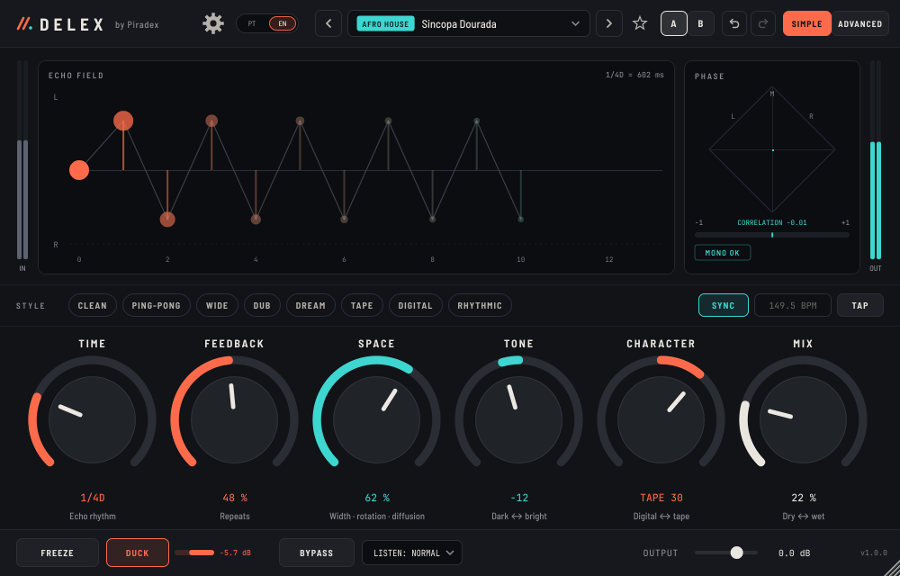
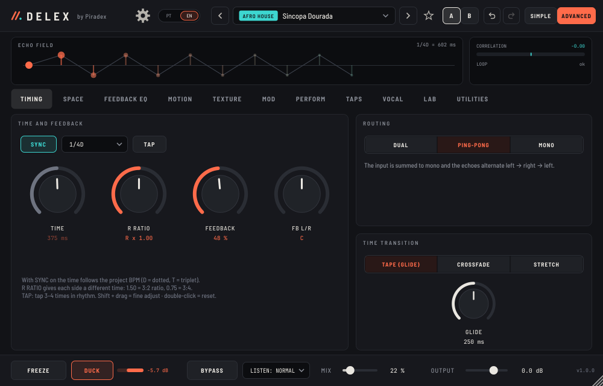
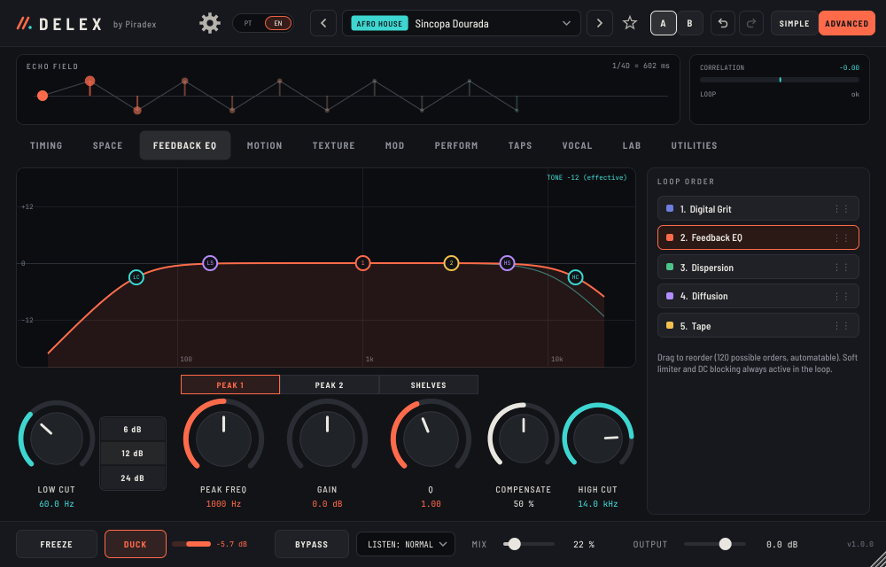
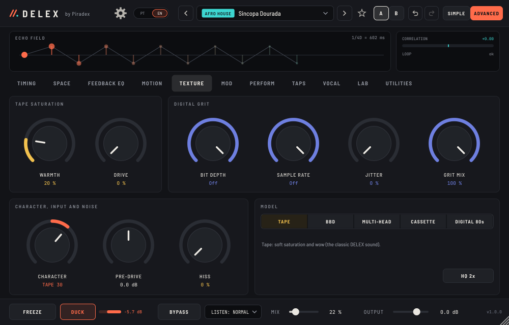
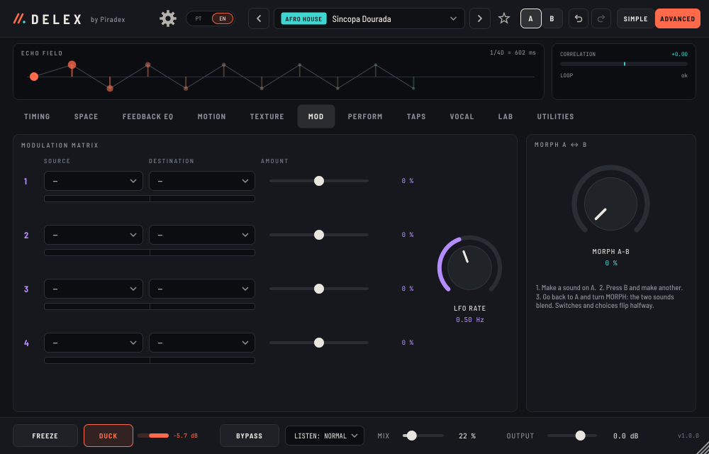
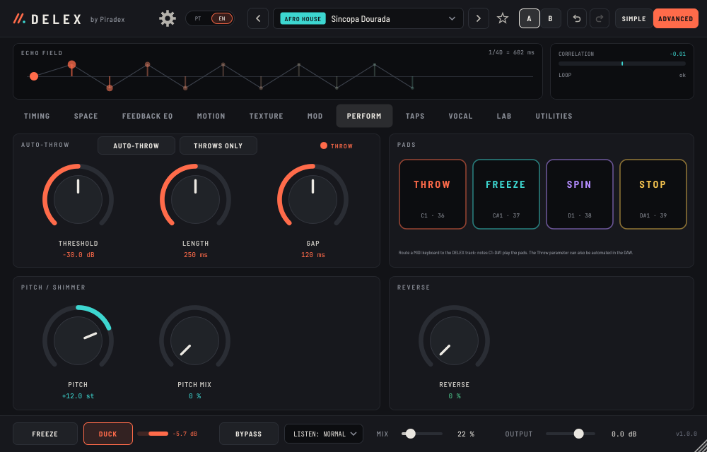
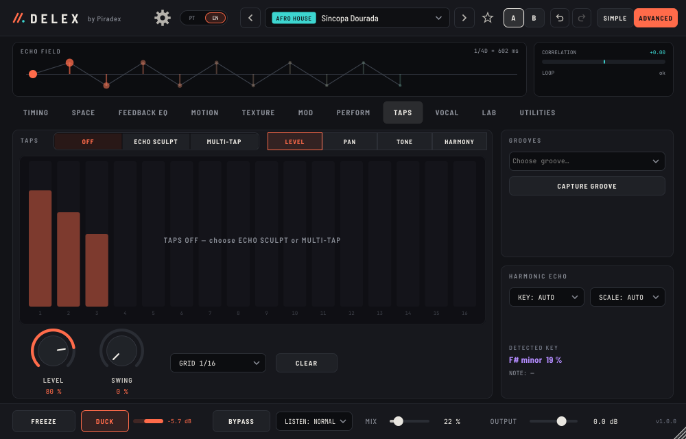
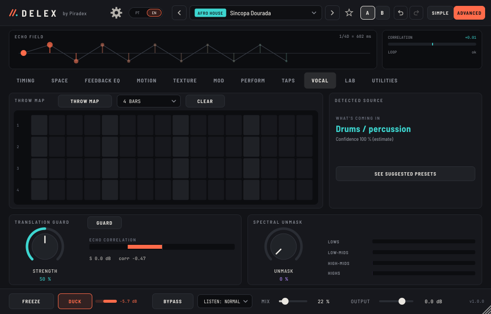
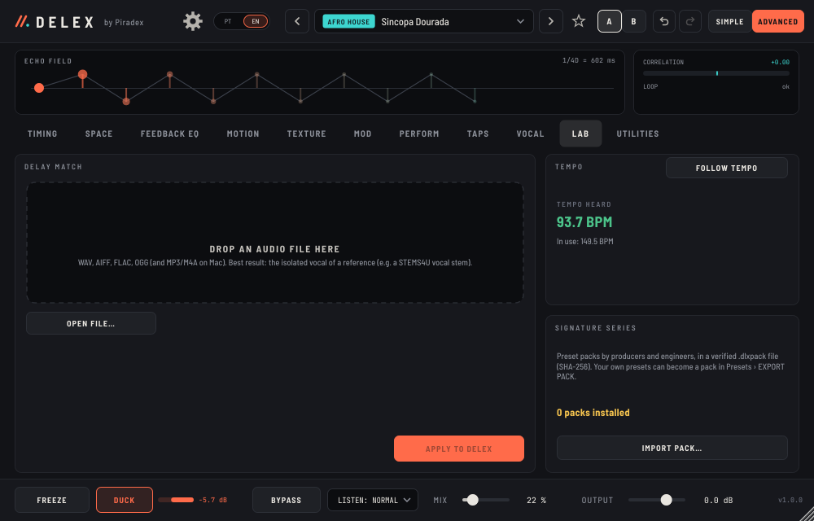
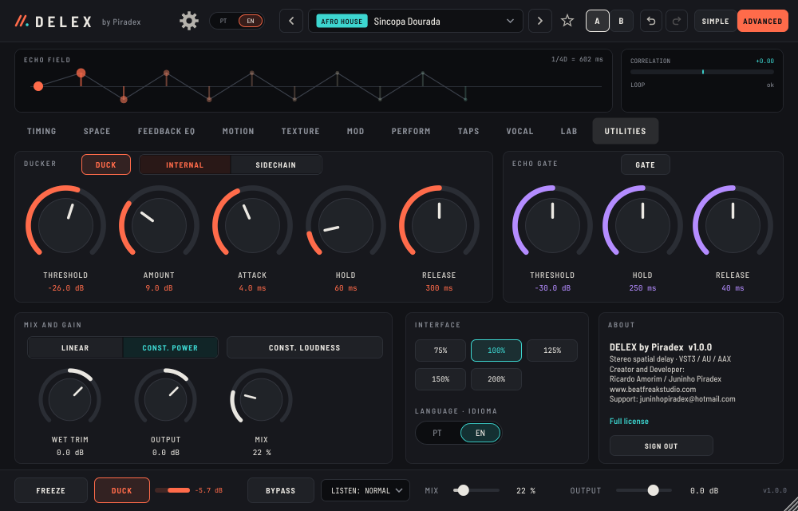

# DELEX by Piradex — User manual

**Version 1.0.0** · Stereo spatial delay · VST3 / AU / AAX · macOS 10.13+ (Intel and Apple Silicon) and Windows 10/11
Creator and Developer: **Ricardo Amorim / Juninho Piradex** · www.beatfreakstudio.com · Support: juninhopiradex@hotmail.com

---

## Contents

1. What DELEX is
2. Installation, password and language
3. Concepts in 5 minutes
4. SIMPLE view
5. Header and footer
6. ADVANCED view, tab by tab
7. Presets, packs and search
8. MIDI: learn, pads and notes
9. Recipes by style
10. Measurements
11. Troubleshooting
12. Quick reference

---

## 1. What DELEX is

DELEX is a stereo delay in which **every repeat can move in space**. The echoes rotate in the stereo field, gain texture and dissolve into a tail, without ever running away in level.

It also solves the problems that waste time in a mix:

- the **last word** that has to go into the delay without drawing automation (Auto-Throw);
- echoes that **smother the vocal** (Ducker, Spectral Unmask);
- echoes that **vanish in mono** or on a phone (Translation Guard);
- tempo that **doesn't lock** to the song (SYNC, Follow tempo, Delay Match);
- rhythms that **don't feel African** (tap grooves, groove capture).

The interface has two views:

- **SIMPLE**: six controls, to get to the sound in seconds.
- **ADVANCED**: eleven tabs with everything else.

Everything works in **Portuguese and English**.

---

## 2. Installation, password and language

**macOS (10.13 or later, Intel and Apple Silicon)**

1. Open the `.dmg`.
2. Run the `.pkg`.

The same installer serves a 2013 MacBook Pro on Catalina and an M1/M2/M3/M4 Mac. If macOS says "unidentified developer": right-click the `.pkg` → Open → Open.

**Windows 10/11 (64-bit)**

1. Run `Setup.exe`.

If "Windows protected your PC" appears: More info → Run anyway. A `.zip` is also available for manual installation: copy `DELEX by Piradex.vst3` to `C:\Program Files\Common Files\VST3`.

**Pro Tools (AAX)**: use the `*-AAX-*.zip` files and follow `LEIA-ME-AAX.txt`.

- Regular Pro Tools needs the AAX signed by PACE.
- The "nao-assinado" (unsigned) files open in Pro Tools Developer.

In your DAW, look for **DELEX by Piradex** (manufacturer Piradex).

- The plugin accepts MIDI, for MIDI learn and the pads.
- In Logic it shows up as a MIDI-controlled effect.

**Password**

- The first time, the plugin asks for a password (master or beta).
- With "Remember on this computer" on, it won't ask again.
- While not signed in, DELEX passes the audio through untouched, so it never breaks your session.
- UTILITIES › ABOUT shows the licence state and lets you **SIGN OUT**.

**Language**

- Click the **⚙ OPTIONS** button in the header and choose **Português** or **English**. The same menu changes the interface size.
- The **PT | EN** switch is also in the header, in UTILITIES › INTERFACE and on the password screen.
- The interface changes straight away, without closing the plugin.
- The choice is shared by every Piradex plugin.
- Parameter names in the DAW never change, so automation keeps working.

---

## 3. Concepts in 5 minutes

**Dry and wet.**

- The original sound is *dry*; the echoes are *wet*.
- **MIX** balances the two.
- On an **aux send** use MIX 100 % and control the level with the send.
- On an **insert** use MIX 10–30 %.

**The feedback loop.**

- Each echo goes back into the delay. **FEEDBACK** is how much goes back.
- Inside the loop are five modules: EQ, tape saturation, diffusion, dispersion and digital grit.
- The modules act *on every pass*: a gentle high cut becomes, by the 6th repeat, a dark tail.
- A soft limiter and a DC blocker are always on inside the loop, so you can go up to 100 % feedback safely.

**The spatial matrix.**

- On every repeat, the left and right echoes go through a rotation (or reflection).
- With ROTATION at 30°, each echo lands a little further to the side than the last.
- It is a unitary operation: the stereo image moves without gaining energy.

**Sync.**

- With **SYNC** on, the time is a note value of the project BPM (1/4, 1/8D, 1/16T…).
- D = dotted, T = triplet.

---

## 4. SIMPLE view

| Area | What it does |
|---|---|
| **ECHO FIELD** | Each dot is a repeat. Height = L/R position; size = level. A hollow ring means L and R are out of phase. |
| **PHASE** | Goniometer and output correlation. "MONO OK" = folds down well to mono. |
| **STYLE** | CLEAN, PING-PONG, WIDE, DUB, DREAM, TAPE, DIGITAL, RHYTHMIC. Starting points that leave time, mix and ducking alone. |
| **SYNC · BPM · TAP** | SYNC locks the time to the BPM. TAP: tap 3–4 times in rhythm; turns SYNC off and sets the time in ms. |
| **TIME** | Note value (with SYNC) or milliseconds (1 ms – 8 s). |
| **FEEDBACK** | Number of repeats. Stable up to 100 %. |
| **SPACE** | Macro: output width, diffusion and rotation. |
| **TONE** | Macro: left darkens the echoes, right brightens them. |
| **CHARACTER** | Macro: right = tape (saturation, warmth, wow); left = digital (bits and sample rate). |
| **MIX** | Dry ↔ wet. |

**Gestures on any knob**

- Drag up or down to change the value.
- **Shift** + drag = fine adjustment.
- **Double-click** = reset to the default value.
- **Double-click the number** = type a value.
- **Right-click** = MIDI learn / forget MIDI / reset value.

---

## 5. Header and footer

**Header**

- **‹ ›**: previous / next preset.
- Preset name: opens the **browser**.
- **★**: favourite.
- **A / B**: stores two versions. **Alt+click** copies the current state to the other slot.
- **↶ ↷**: undo / redo.
- **SIMPLE / ADVANCED**: switches view.

**Footer**

- **FREEZE**: freezes the tail. No new sound comes in and the echoes repeat without loss.
- **DUCK**: the echoes dip while the source plays. The bar next to it shows the reduction in dB.
- **BYPASS**: turns the effect off without clicks.
- **LISTEN**: for monitoring only, never saved in presets. The box turns orange outside Normal so you don't forget.
  - **Normal**
  - **Wet Solo**: echoes only.
  - **Delta**: only what the delay adds, at the current mix.
  - **Mono**
  - **Phone**: 400 Hz – 3.5 kHz band.
  - **Club**: mono lows.
- **MIX** (in the ADVANCED view) and **OUTPUT**.

---

## 6. ADVANCED view, tab by tab

The ECHO FIELD and PHASE sit at the top; below them are eleven tabs.

### TIMING

- **TIME** (ms), **SYNC** + note value, **TAP**.
- **R RATIO**: right-side time relative to the left. 1.50 = 3:2 ratio; 0.75 = 3:4.
- **FEEDBACK** and **FB L/R** (feedback balance between the sides).
- **Routing**:
  - **Dual**: two delays.
  - **Ping-Pong**: input summed; the echoes alternate left → right.
  - **Mono**: a single centred echo. Ideal for 808s and bass.
- **Time transition** and **GLIDE**:
  - **Tape (glide)**: the time glides, with a pitch change.
  - **Crossfade**: smooth switch without a pitch change.
  - **Stretch**: the time glides at the GLIDE speed, but without a pitch change.

### SPACE

- **ROTATION** (−180°…+180°), in **Rotation** or **Reflection** mode. Reflection mirrors the field on every repeat.
- **IN ROT / OUT ROT** (±45°). At 45° it converts L/R to M/S.
- **IN WIDTH / OUT WIDTH** (0–200 %). Above 100 % the level is compensated.
- **SPACE** macro.
- **MONO-SAFE**: echo lows (< 150 Hz) in mono.

### FEEDBACK EQ

**The curve** has 6 nodes: **LC** (low cut), peak **1**, peak **2**, **LS** (low shelf), **HS** (high shelf) and **HC** (high cut).

- Drag a node to move it.
- The mouse wheel on a peak changes its Q.
- Double-click a node to reset it.

**Knobs**

- **LOW CUT** and **SLOPE** (6/12/24 dB per octave).
- **PEAK 1 / PEAK 2 / SHELVES**: choose which band the knobs show.
- **COMPENSATE**: lowers the feedback in proportion to the largest positive gain, so the loop doesn't run away.
- **HIGH CUT**.

With COMPENSATE at 0 % and a positive peak, the loop can self-oscillate (dub effect). The limiter protects you, but turn your monitors down before trying it.

**LOOP ORDER**: drag Digital Grit, Feedback EQ, Dispersion, Diffusion and Tape into any position. That gives 120 orders, all automatable.

### MOTION

- **Modulation**:
  - DEPTH (cents);
  - RATE or a synced note value;
  - OFFSET between L and R (50 % = opposite);
  - Sine / Triangle / Random shape;
  - **WOW** (tape wow and flutter).
- **Dispersion**: frequency and spread in ms. Smears the echo in time ("chirp" effect).
- **Diffusion**: amount and spread. Goes from a discrete echo to a reverb-like tail.

### TEXTURE

- **Tape**: WARMTH (pre-emphasis) and DRIVE (anti-aliased saturation).
- **Digital grit**: BIT DEPTH, SAMPLE RATE, JITTER, GRIT MIX.
- **CHARACTER**, **PRE-DRIVE** and **HISS** (tape noise on the echoes only).
- **MODEL**:
  - **Tape**: the classic DELEX sound.
  - **BBD**: analog chip delay. The longer the time, the darker.
  - **Multi-head**: three heads at 1/3, 2/3 and the full time. Choose the heads: 1, 2, 3, 1+2, 1+3, 2+3 or 1+2+3.
  - **Cassette**: narrow band, extra wow and small level drifts.
  - **Digital 80s**: 12 bits and bandwidth up to 12 kHz.
- **HQ 2x**: saturation with 2× oversampling. Its 14-sample latency is compensated in the delay time.

### MOD

**Modulation matrix** with 4 slots. Each slot has:

- a **source**:
  - **LFO** (sine, LFO RATE);
  - input **Envelope**;
  - **Random** (sample & hold at the RATE);
  - **Sidechain** (envelope of the sidechain input);
- a **destination**: TIME, FEEDBACK, MIX, ROTATION, LOW CUT, HIGH CUT, PEAK FREQ, DRIVE, DIFFUSION, OUT WIDTH, PITCH MIX, REVERSE, MOD DEPTH, WET TRIM, TONE or SPACE;
- an **amount**: ±100 % = the destination's full range.

TIME is special: it multiplies the final time (±1 octave) and works with SYNC. The bar under each row shows the source moving.

**MORPH A ↔ B** slides every parameter from the current slot to the other slot's. Switches and choices flip halfway. Automate it to move from one sound to another in a transition.

### PERFORM

**AUTO-THROW**

- DELEX detects the end of each phrase: the level stays below the **THRESHOLD** for the length of the **GAP**.
- It then writes the last word (**LENGTH**) straight into the delay line, where it would have gone in.
- The echo comes out on time, as if you had opened the send before the word.
- The THROW light flashes on every throw.

**THROWS ONLY**: the input only enters the delay on throws:

- Auto-Throw;
- the THROW pad;
- the Throw Map;
- the automated **Throw** parameter.

**Pads** (mouse or MIDI):

- **THROW**: throws the last phrase now and keeps the send open.
- **FREEZE**
- **SPIN**: one full turn around the stereo field per bar.
- **STOP**: tape stop; on release, the echoes come back.

**PITCH / SHIMMER**: pitch inside the loop. Each repeat goes up (or down) again; +12 with PITCH MIX ≈ 40 % is the shimmer.

**REVERSE**: reversed echoes, in segments as long as the delay time.

### TAPS

**Modes**

- **ECHO SCULPT**: draw each of the 16 repeats. Replaces the loop echoes.
- **MULTI-TAP**: up to 31 echoes at free grid positions (1/16, 1/16T or 1/8), added to the loop echoes. **SWING** delays the weak sixteenths.

**Lanes**

- **LEVEL**, **PAN** and **TONE** (each tap's filter).
- **HARMONY**: a click changes the interval (3rd, 5th, octave, −octave, 4th, 6th, 7th).
- A right-click clears a step.

**GROOVES**: patterns inspired by African and diaspora rhythms:

- Kizomba
- Semba
- Kuduro
- Afro House
- Amapiano (log drum)
- Gqom
- Afrobeats 3-3-2
- Highlife
- Coupé-Décalé
- 12/8 bell
- Marrabenta
- Tarraxinha

**CAPTURE GROOVE**

1. Press the button.
2. Play one bar (drums, percussion, vocal…).
3. DELEX waits for the first hit, listens for one bar and turns the hits into taps.

**HARMONIC ECHO**

- The **key** is detected from the input, or you choose KEY and SCALE.
- The current **note** is detected too.
- Intervals are diatonic: a "3rd" can be major or minor depending on the scale degree, so the echo harmonises within the key.

### VOCAL

**THROW MAP**

- Mark the words and phrases to throw, over 1 to 8 bars of sixteenths.
- With the DAW playing, the send opens on those steps.
- Use it with THROWS ONLY.

**DETECTED SOURCE**

- DELEX listens to what's coming in: vocal, drums/percussion, bass/808, guitar/keys, pad/synth or full mix.
- **SEE SUGGESTED PRESETS** opens the matching category.

**TRANSLATION GUARD** protects the echoes on mono, phones and clubs:

- it fixes out-of-phase echoes by gently flipping the polarity of the echoes' right side;
- it limits width down to the minimum correlation set by **STRENGTH**;
- it makes the echo lows mono.

**SPECTRAL UNMASK**

- The echoes dip (up to 12 dB) only in the bands where the source, or the sidechain, is playing: lows, low-mids, high-mids and highs.
- The vocal stays clear and the tail stays there.

### LAB

**DELAY MATCH**

1. Drop a file on the dashed area, or use OPEN FILE. Formats: WAV, AIFF, FLAC, OGG; on Mac also MP3 and M4A.
2. DELEX measures the delay in it: time, feedback, echo brightness (TONE), width and whether it is ping-pong.
3. Press **APPLY TO DELEX** to copy those values. If the time is within ±3 % of a note value at the current BPM, SYNC is switched on.

The best results come from the **isolated vocal** of a reference, for example a **STEMS4U** vocal stem: the rhythm of the other instruments can't confuse the measurement.

**FOLLOW TEMPO**: uses the tempo heard at the input instead of the DAW's (live, or in a DAW without tempo).

**SIGNATURE SERIES**: import packs (see 7).

### UTILITIES

- **DUCKER**:
  - THRESHOLD, AMOUNT, ATTACK, HOLD, RELEASE;
  - **INTERNAL / SIDECHAIN** key;
  - the indicator reads *SIDECHAIN RECEIVING* when the DAW sends signal.
- **ECHO GATE**: GATE, THRESHOLD, HOLD, RELEASE. The tail cuts off abruptly when the source stops — the "NonLin" sound.
- **MIX AND GAIN**:
  - LINEAR / CONST. POWER curve;
  - **CONST. LOUDNESS**: the echo level stays the same when you change the feedback, so comparisons don't fool your ears;
  - WET TRIM, OUTPUT, MIX.
- **INTERFACE**: size 75–200 % and language.
- **ABOUT**: version, credits, licence, SIGN OUT.

---

## 7. Presets, packs and search

**482 factory presets** in 30 categories. The 200 from the *Delay FX · 200 professional presets* guide (Beatfreak Music) are in the Classic, Stereo, Vintage, Rhythmic, Afro, EDM, Pitch, Reverse, Modulation, Mixing and Next Gen categories, and also in Vocals, Trap, Guitar, Drums, Synth, Ambient, FX and Dub. The 19 original categories:

| Category | Presets |
|---|---|
| Vocals | 52 |
| Afro House | 6 |
| Kizomba | 5 |
| Trap | 6 |
| Drums (Fills, Snare, Percussion) | 38 |
| Bass (Ambience, Chorus, Room) | 24 |
| Guitar | 18 |
| Synth | 41 |
| Ambience | 20 |
| Ambient | 5 |
| Orkestra (Chamber, Big Hall) | 13 |
| Mega (cinematic) | 8 |
| NonLin (Snare, Toms) | 16 |
| VIP (studio techniques) | 9 |
| FX | 4 |
| Lo-Fi | 5 |
| Dub | 5 |
| Transition | 4 |
| Master FX | 3 |

**Search by description**

Type what you want to hear, for example:

- "dark wide vocal"
- "short snare"
- "voz escura e larga"
- "kizomba groove"

DELEX understands synonyms in English and Portuguese and ranks the closest matches first: category, then name, tags and description.

**In the browser**

- ★ favourites;
- **SAVE AS…** for your own presets;
- **FOLDER** opens the presets folder;
- double-click or **LOAD** applies the preset.

**LOCK** TIME / MIX / DYN. / EQ keeps those groups when you change preset. That way you can browse presets without losing the time and mix you set for the song.

**Signature Series packs (.dlxpack)**

- **IMPORT PACK…**: the presets appear under *User*, with the pack name and author.
- Each preset carries its SHA-256: a modified pack is rejected.
- **EXPORT PACK…**: bundles your presets into a pack to share or sell.
- Alternatively, `tools/make_pack.py` builds packs with a cover and per-preset descriptions.

**User presets folder**

- macOS: `~/Library/Application Support/Piradex/DELEX/Presets`
- Windows: `%APPDATA%\Piradex\DELEX\Presets`

---

## 8. MIDI: learn, pads and notes

**MIDI learn**

1. Right-click a knob or button → *MIDI learn*.
2. Move a control on your controller.

The knob now shows `CC n`. Each parameter maps to one CC only, and the map is saved with the session.

**Pads over MIDI**

| Note | Pad |
|---|---|
| C1 (36) | THROW |
| C#1 (37) | FREEZE |
| D1 (38) | SPIN |
| D#1 (39) | STOP |

**Routing MIDI to DELEX**

| DAW | How |
|---|---|
| Logic | choose the DELEX track as the MIDI destination |
| Ableton | on a MIDI track, *MIDI To* = DELEX track → DELEX |
| FL Studio | the wrapper's MIDI port |
| Reaper | a MIDI send to the track |

---

## 9. Recipes by style

**Kizomba / Tarraxinha — lead vocal**

- Preset *Kizomba Romântica* on a send at 100 %.
- DUCK on.
- VOCAL › UNMASK 40 %.
- For groove in the echoes: TAPS › GROOVES › Kizomba, LEVEL 60 %.

**Afro House — syncopated and wide**

- *Sincopa Dourada*, or the PING-PONG style with TIME 1/4D.
- TAPS › Afro House on top.
- SPACE 50 %.

**Amapiano**

- TIME 1/4D, MODEL BBD.
- TAPS › Amapiano (log drum).
- On drums: NonLin with GATE.

**Trap / Drill — throw the last word**

- PERFORM: AUTO-THROW + THROWS ONLY.
- LENGTH 250 ms, GAP 120 ms.
- TIME 1/8D, FEEDBACK 35 %.

**Pop / R&B — clean vocal with a tail**

- TIME 1/4, FEEDBACK 40 %.
- DUCKER › SIDECHAIN keyed from the vocal itself.
- UNMASK 60 %, GUARD on.

**Cinematic shimmer**

- PITCH +12, PITCH MIX 40 %.
- Diffusion 60 %, FEEDBACK 70 %.

**Vintage tape echo**

- MODEL Multi-head, heads 1+2+3.
- DRIVE 30 %, WOW 20 %.

**Transition into the chorus**

1. On A, make a short delay.
2. On B, make a huge tail with FREEZE ready.
3. Go back to A and automate MORPH from 0 to 100 % over the 2 bars before the chorus.
4. Hit the STOP pad on the last beat.

**Copy the delay from a reference**

1. Split the reference's vocal with STEMS4U.
2. Drop the stem on LAB › DELAY MATCH.
3. Press APPLY TO DELEX.

**Mixing and mastering**

- Master FX category, with a low MIX (5–10 %).
- MONO-SAFE and GUARD on.
- Check in LISTEN › Mono and › Phone.

---

## 10. Measurements

The engine's objective curves are in [MEASUREMENTS.md](MEASUREMENTS.md), following the ANALYSER by Piradex methodology: tail per model, response of the repeats, THD and harmonics, aliasing, ducker, timing accuracy and CPU.

Highlights:

- 50 % feedback gives exactly −6 dB per repeat;
- timing error is ≤ 1 sample, from 1 ms to 8 s;
- zero latency;
- aliasing at −109 dB with HQ 2x.

---

## 11. Troubleshooting

| Problem | Solution |
|---|---|
| The plugin doesn't appear | Rescan plugins. On Mac, check that the AU is in `/Library/Audio/Plug-Ins/Components`. In Logic, reopen the Plug-in Manager. |
| No effect is heard | Check you're signed in (UTILITIES › ABOUT), the MIX, BYPASS and LISTEN (Normal). With THROWS ONLY on, only throws enter the delay. |
| The echoes don't follow the BPM | Turn SYNC on. Without DAW tempo, use TAP or FOLLOW TEMPO. |
| The sidechain doesn't work | Choose SIDECHAIN in the ducker and route the sidechain input in your DAW (see docs/TESTES_DAW.md). The indicator should read *RECEIVING*. |
| MIDI learn doesn't respond | The controller's MIDI must reach the DELEX track (see 8). |
| Level rises as feedback goes up | That's natural: there are more repeats. Turn CONST. LOUDNESS on to compare. |
| The tail sounds weak in mono | Turn GUARD on and check in LISTEN › Mono. |
| Delay Match says "no clear echo" | Use the isolated vocal (stem) and a section with phrases and gaps. Files shorter than 3 s won't work. |

**Support**: juninhopiradex@hotmail.com. Include your system, DAW and version, plus a screenshot.

---

## 12. Quick reference

| Gesture | Action |
|---|---|
| Shift + drag | fine adjustment |
| Double-click | reset |
| Double-click the number | type a value |
| Right-click | MIDI learn / forget / reset |
| Alt + click on A/B | copy the state to the other slot |
| Mouse wheel on an EQ peak | change the Q |
| Notes C1–D#1 | THROW, FREEZE, SPIN, STOP pads |

Interface fonts: Barlow Semi Condensed and JetBrains Mono (SIL Open Font License). Built with JUCE.
© Ricardo Amorim / Juninho Piradex · www.beatfreakstudio.com
