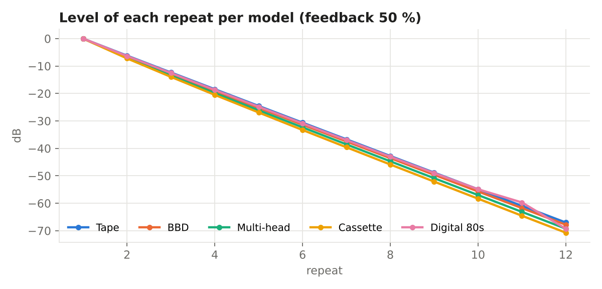
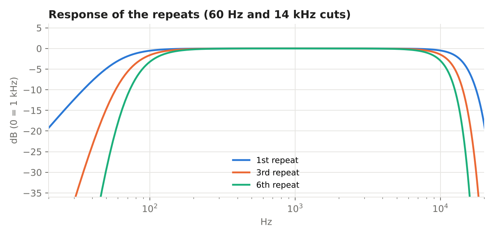
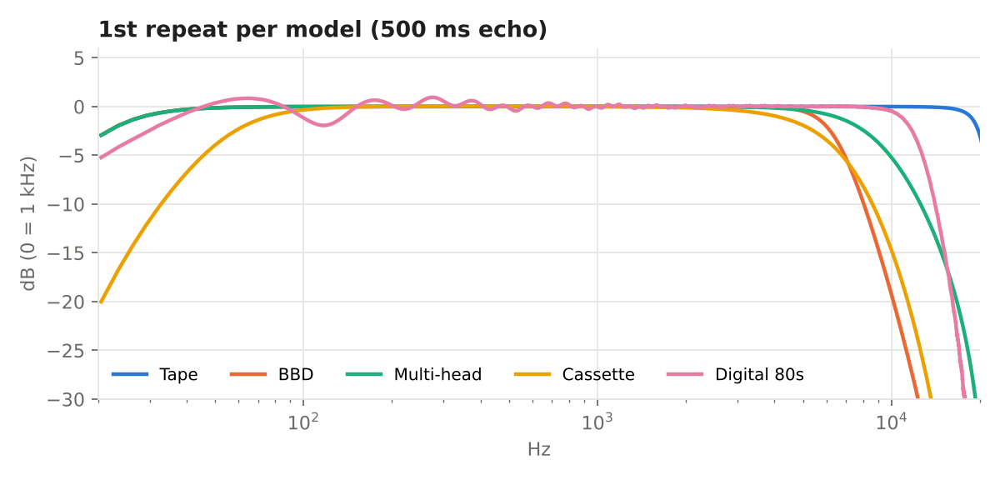
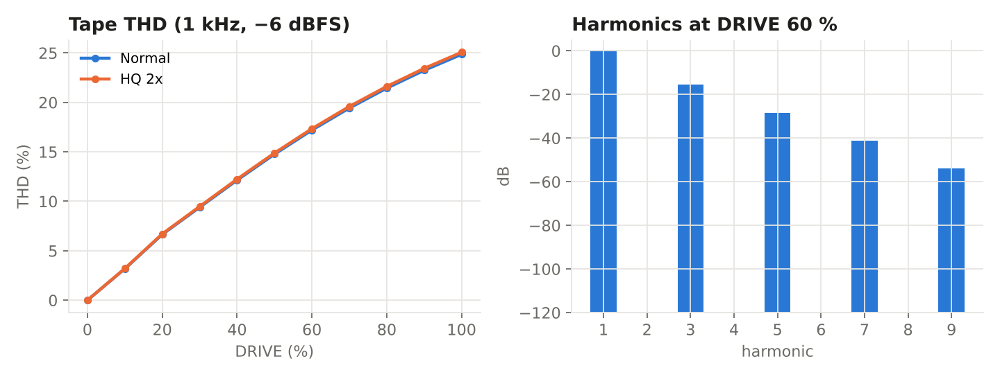
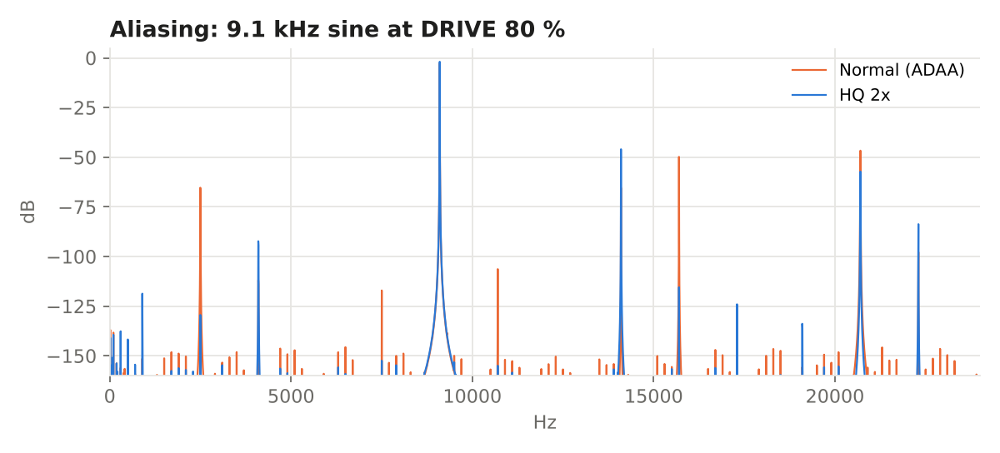
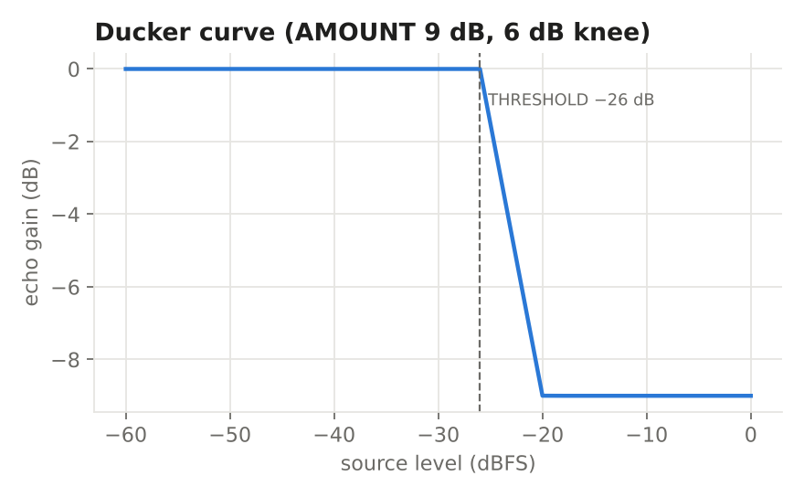
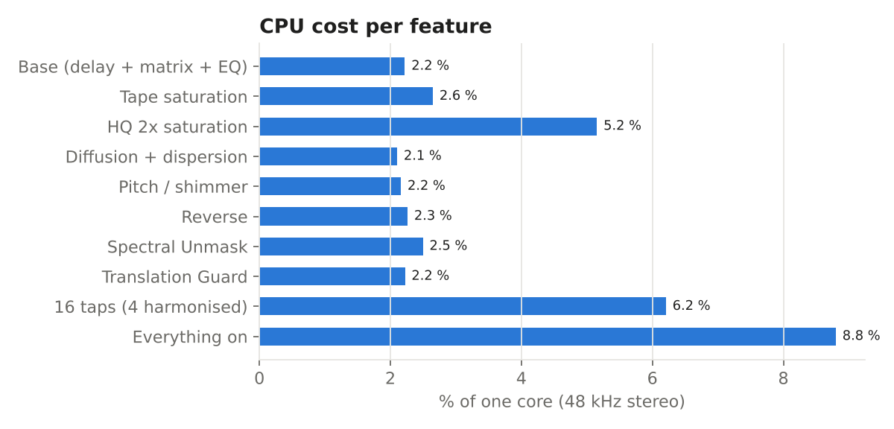

# DELEX by Piradex — measurements

Objective measurements of the DELEX 1.0 engine, following the **ANALYSER by Piradex** methodology: impulse and short noise for each repeat's response, sines for THD, harmonics and aliasing, a level sweep for the ducker, silence for the noise floor. All at 48 kHz, single precision, as in the plugin. The numbers come from `tests/measure.cpp` and the curves from `tools/plot_medicoes.py` — anyone can repeat them.

## Summary

| Measurement | Result |
|---|---|
| Tape: drop per repeat (feedback 50 %) | -6.1 dB |
| 1st repeat: 60 Hz relative to 1 kHz | -3.2 dB |
| 1st repeat: 14 kHz relative to 1 kHz | -3.0 dB |
| 6th repeat: 10 kHz relative to 1 kHz | -3.0 dB |
| THD at DRIVE 60 % (1 kHz, −6 dBFS) | 17.2 % |
| Alias at 2.5 kHz (normal) | -45.4 dB |
| Alias at 2.5 kHz (HQ 2x) | -109.5 dB |
| Noise floor (silence, feedback 90 %) | digital silence |
| HISS at maximum | -55.2 dBFS RMS |
| Max echo time error (1 ms … 8 s) | 1 samples |
| Mono sum of out-of-phase echoes, GUARD off | -150.0 dB |
| Mono sum of out-of-phase echoes, GUARD on | -0.0 dB |
| Base CPU (one core, 48 kHz stereo) | 2.2 % |
| CPU with everything on | 8.8 % |
| Plugin latency | 0 samples |

## Echo tail per model

At 50 % feedback each repeat drops 6 dB (the maths says 20·log10(0.5) = −6.02 dB): FEEDBACK does exactly what it says. Cassette loses a little more because its narrow band and saturation act on every pass.

## Response of the repeats

Low cut 60 Hz and high cut 14 kHz (12 dB/octave) inside the loop. The cuts add up on every pass: repeats get progressively darker and lighter in the lows, like a well-tuned analog delay.

## Character of the models

First repeat of each model, normalised at 1 kHz.

## Tape saturation

Distortion rises smoothly with DRIVE and is dominated by low odd harmonics (tape character). At 0 % DRIVE the loop is linear.

## Aliasing

Even without oversampling the saturation uses antiderivative anti-aliasing (ADAA). HQ 2x pushes aliasing below the noise floor.

## Ducker

Reduction versus source level, with a soft 6 dB knee from the THRESHOLD.

## CPU

Measured on a modern core; a 2013 MacBook Pro uses roughly twice as much, still comfortable.

Repeat: `g++ -O2 -std=c++17 -ISource tests/measure.cpp -o measure && ./measure docs/medicoes/data && python3 tools/plot_medicoes.py`
