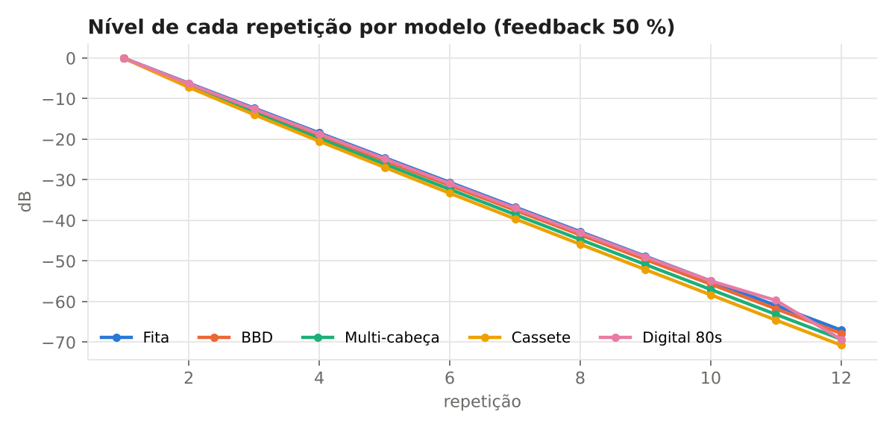
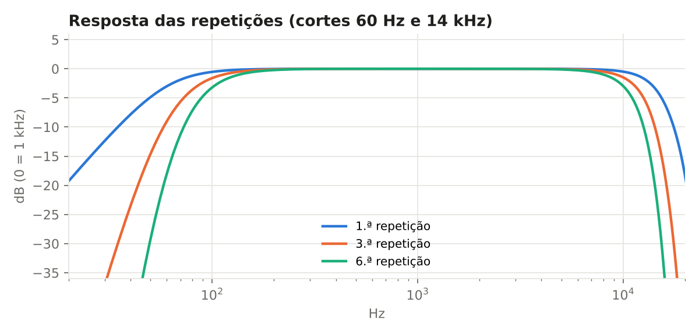
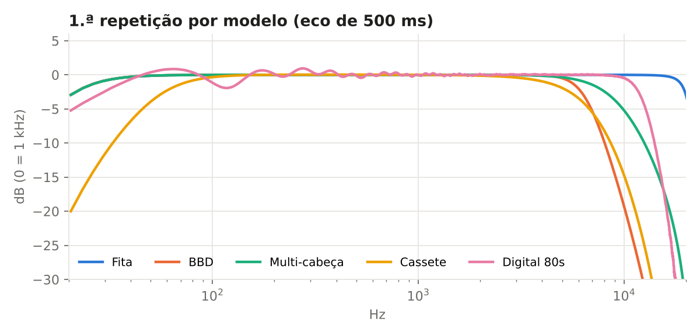
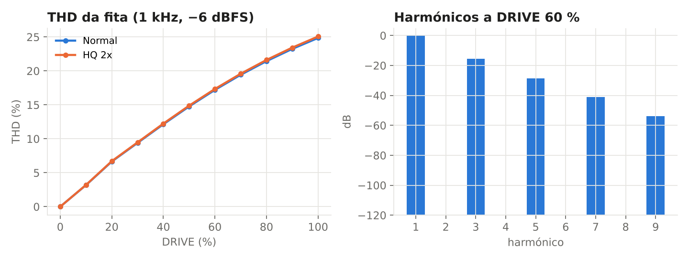
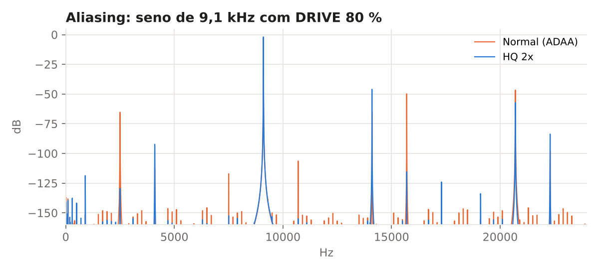
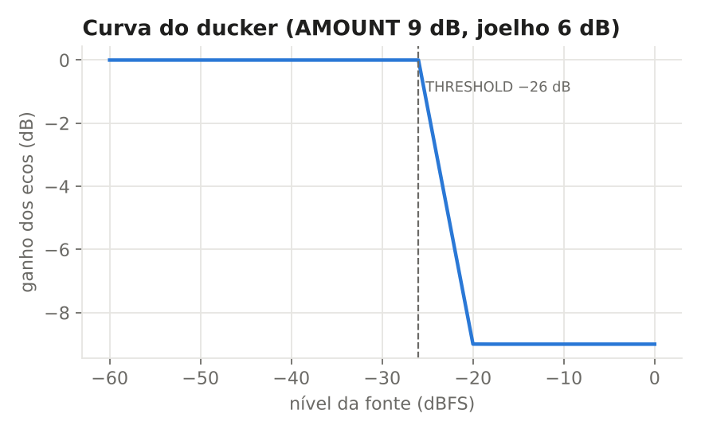
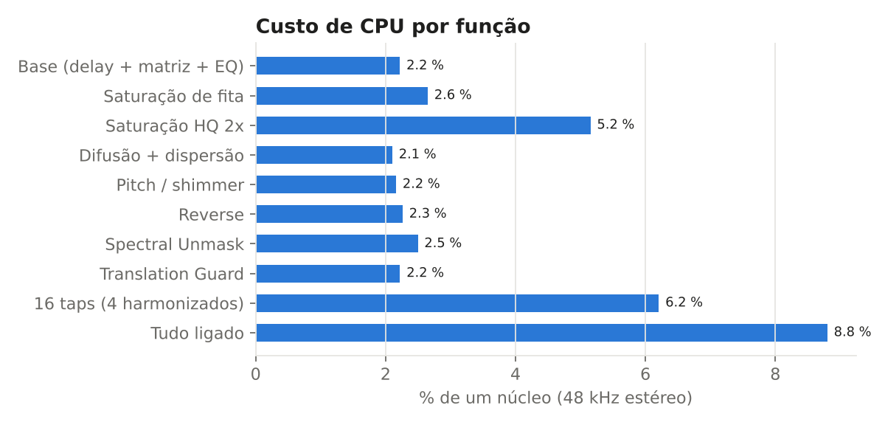

# DELEX by Piradex — medições

Medições objectivas do motor do DELEX 1.0, feitas com a metodologia do **ANALYSER by Piradex**: impulso e ruído curto para a resposta de cada repetição, senos para THD, harmónicos e aliasing, varrimento de nível para o ducker, silêncio para o ruído de fundo. Tudo a 48 kHz, em precisão simples, como no plugin. Os números são gerados por `tests/measure.cpp` e as curvas por `tools/plot_medicoes.py` — qualquer pessoa pode repetir.

## Resumo

| Medição | Resultado |
|---|---|
| Fita: queda por repetição (feedback 50 %) | -6.1 dB |
| 1.ª repetição: 60 Hz em relação a 1 kHz | -3.2 dB |
| 1.ª repetição: 14 kHz em relação a 1 kHz | -3.0 dB |
| 6.ª repetição: 10 kHz em relação a 1 kHz | -3.0 dB |
| THD a DRIVE 60 % (1 kHz, −6 dBFS) | 17.2 % |
| Alias a 2,5 kHz (normal) | -45.4 dB |
| Alias a 2,5 kHz (HQ 2x) | -109.5 dB |
| Ruído de fundo (silêncio, feedback 90 %) | silêncio digital |
| HISS no máximo | -55.2 dBFS RMS |
| Erro máximo do tempo do eco (1 ms … 8 s) | 1 amostras |
| Soma mono dos ecos em contrafase, sem GUARD | -150.0 dB |
| Soma mono dos ecos em contrafase, com GUARD | -0.0 dB |
| CPU base (um núcleo, 48 kHz estéreo) | 2.2 % |
| CPU com tudo ligado | 8.8 % |
| Latência do plugin | 0 amostras |

## Cauda de ecos por modelo

Com feedback 50 % cada repetição perde 6 dB (a matemática pede 20·log10(0,5) = −6,02 dB): o FEEDBACK faz exactamente o que diz. A Cassete perde um pouco mais porque a banda estreita e a saturação actuam a cada volta.

## Resposta das repetições

Low cut 60 Hz e high cut 14 kHz (12 dB/oitava) dentro do loop. Os cortes somam-se a cada volta: as repetições escurecem e perdem graves de forma progressiva, como num delay analógico bem regulado.

## Carácter dos modelos

Primeira repetição de cada modelo, normalizada a 1 kHz.

## Saturação de fita

A distorção cresce de forma suave com o DRIVE e é dominada pelos harmónicos ímpares baixos (carácter de fita). Com DRIVE a 0 % o loop é linear.

## Aliasing

Mesmo sem oversampling a saturação usa anti-aliasing por derivada (ADAA). O HQ 2x leva o aliasing para baixo do ruído de fundo.

## Ducker

Redução em função do nível da fonte, com joelho suave de 6 dB a partir do THRESHOLD.

## CPU

Medido num núcleo moderno; um MacBook Pro 2013 gasta cerca do dobro, ainda folgado.

Repetir: `g++ -O2 -std=c++17 -ISource tests/measure.cpp -o measure && ./measure docs/medicoes/data && python3 tools/plot_medicoes.py`
